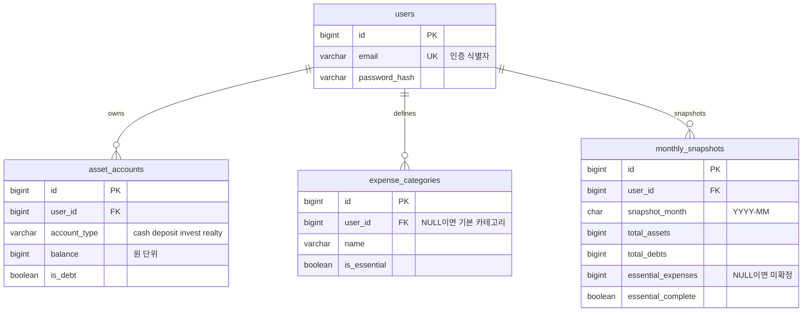

# 프로젝트 운영 기준 (AI + Agile)

> 이 문서는 **영구 결정**의 단일 출처다. 장(§) 번호로 참조한다.
> 시간순 작업 진행과 남은 일은 `.ai/session-log.md` 에 있다.

## 1) 기술 스택
현행 기준 (레거시 호환, 신규 화면에 적용 금지):
Frontend:
- React 16
- TypeScript
- antd 4
- ag-grid 21 (폐기: 현 MVP는 antd Table 사용. 대용량 표 필요 시 도입)
- webpack

Backend:
- Language: Java
- JDK: Java 17
- Framework: Spring Boot
- ORM / SQL Mapper: MyBatis
- Database: [Oracle / PostgreSQL / MySQL 등]
- Build Tool: Maven
- API: REST

권장 기준 (2026, 한국 실무 다수 패턴) - 확정:
Frontend:
- React 18
- TypeScript (strict)
- Vite (신규/개선 화면 우선)
- Next.js (SSR/SEO 요구 화면이 있을 때 선택) - AssetFlow는 해당 없음
- 상태 관리: TanStack Query + 최소 전역 상태
- UI: antd 6
	- antd 4에서 6으로 상향: 하위 호환 없음, React 18+ 필수
- 스타일: antd ConfigProvider theme 토큰만 사용. 유틸리티 CSS/CSS-in-JS 미도입
- 차트: Apache ECharts(Apache-2.0) + echarts-for-react(MIT)
- 공통 컴포넌트: Storybook으로 문서화

Backend:
- Language: Java 21 (LTS 권장)
- Framework: Spring Boot 3.3+
- Data Access: MyBatis 유지 + JPA/QueryDSL 선택 병행
- Database: PostgreSQL 우선, 필요 시 기존 DB 병행
- Build Tool: Gradle 또는 Maven (팀 표준 1개로 고정)
- API: REST + OpenAPI 스펙 관리
- Cache/Async: Redis, 메시지 큐(Kafka/RabbitMQ) 필요 시 도입

DevOps:
- GitHub Actions 기반 CI
- 필수 체크: build, test, lint, security
- 컨테이너 표준: Docker
- 패키지 매니저: pnpm 단독 (npm/yarn 미사용, §30)

단계적 적용 우선순위:
1. PR/리뷰/테스트 게이트 고정 (이미 적용)
2. FE 신규 화면부터 Vite + Storybook 적용 (패키지 매니저는 pnpm, §30)
3. BE 신규 모듈부터 Spring Boot 3.3+/Java 21 적용
4. API OpenAPI 문서화 및 계약 테스트 도입
5. CI 필수 체크 자동화 고도화

## 2) 절대 원칙
- 기존 공통 Grid 컴포넌트를 직접 수정하지 않는다.
- API 변경 시 다른 화면 사용 여부를 반드시 확인한다.
- 요구사항에 없는 리팩토링은 하지 않는다.
- 변경은 최소 단위로 하고, 근거를 남긴다.

## 3) 애자일 운영 규칙
- 스프린트 기간: 1~2주
- 작업 단위: 사용자 스토리 + 수용 기준(AC)
- WIP 제한: 한 담당자당 진행중 이슈 최대 2개
- 이벤트: 계획(Plan) -> 데일리(Daily) -> 리뷰(Review) -> 회고(Retrospective)

## 4) DoR / DoD
DoR (착수 조건):
- 요구사항이 사용자 스토리로 정리되어 있다.
- 수용 기준(AC)이 3개 이상 있다.
- 영향 범위(FE/BE/DB/API)가 명시되어 있다.
- 불확실 항목과 질의사항이 정리되어 있다.

DoD (완료 조건):
- 코드 구현 + 리뷰 + 테스트 결과가 문서화되어 있다.
- 회귀 영향 확인이 끝났다.
- 배포/롤백 포인트가 정리되어 있다.
- 남은 리스크와 후속 과제가 기록되어 있다.

## 5) AI 사용 정책
- 허용: 코드 요약, 영향 분석, 테스트 케이스 초안, 리뷰 체크리스트 생성
- 금지: 비밀키/개인정보/고객식별정보/내부 인증정보 입력
- 검증 책임: AI가 제안한 내용은 각 담당자가 코드/로그/테스트로 검증 후 확정
- 기록 의무: AI 사용 시 "무엇을 물었고 무엇을 채택했는지"를 작업 메모에 남긴다.

## 6) 브랜치/PR 규칙
- 브랜치: feature/*, bugfix/*, hotfix/*
- PR 필수 항목: 변경 요약, 영향 범위, 테스트 결과, 롤백 방법
- 병합 조건: Blocker/Critical 이슈 0건

## 7) 릴리즈/롤백 기준
- API/DB 스키마 변경 시 하위 호환 여부를 먼저 명시한다.
- 롤백 가능한 단위로 배포한다.
- 장애 발생 시 복구 절차와 담당자를 사전에 지정한다.

## 8) 최근 개발 트렌드 반영 기준 (React + Java)
- 큰 변경 1건보다 작은 PR 여러 건을 우선한다.
- Feature Flag를 활용해 배포와 기능 오픈 시점을 분리한다.
- 모듈러 모놀리스 기반으로 시작하고, 운영 필요 시에만 서비스 분리를 검토한다.
- API는 계약(OpenAPI/요청-응답 스키마) 중심으로 관리한다.
- 관측성(로그/메트릭/트레이싱)과 장애 복구 가능성을 설계 단계에서 포함한다.
- AI는 초안 생성 도구로 사용하고, 최종 책임은 사람 검증으로 확정한다.

## 9) PR 운영 상세 규칙
PR 목적:
- 코드 품질 확보
- 변경 이력과 의사결정 기록
- 회귀/장애 예방

PR 작성 규칙:
- 한 PR은 한 가지 목적만 담는다.
- PR 본문에 변경 목적, 영향 범위, 테스트 결과, 롤백 방법을 반드시 작성한다.
- UI 변경이 있으면 화면 증거(캡처 또는 Storybook 링크)를 첨부한다.

PR 병합 규칙:
- 빌드/테스트/린트/보안 체크 통과 후 병합한다.
- Blocker/Critical 이슈가 하나라도 있으면 병합하지 않는다.
- CODEOWNERS 대상 영역은 지정 리뷰어 승인 후 병합한다.

권장 PR 템플릿:
1. 변경 목적
2. 변경 내용
3. 영향 범위 (FE/BE/API/DB)
4. 테스트 방법 및 결과
5. 리스크 및 롤백 방법
6. 체크리스트 (AC 충족/호환성/문서 업데이트)

## 10) Storybook 운영 기준
목적:
- UI 컴포넌트를 독립적으로 개발/검증/문서화한다.

적용 대상:
- 공통 UI 컴포넌트
- 재사용 가능한 도메인 컴포넌트

필수 스토리:
- 기본 상태
- 로딩 상태
- 빈 데이터 상태
- 에러 상태
- 비활성/권한 제한 상태

운영 규칙:
- UI 변경 PR에는 관련 Storybook 스토리를 함께 갱신한다.
- 스토리 이름은 도메인/컴포넌트/상태를 일관되게 사용한다.
- 테스트 담당자는 Storybook 기준으로 시각 회귀를 우선 확인한다.

## 11) FE 개발자용 백엔드 학습 병행 트랙
원칙:
- 업무와 학습을 분리하지 않고 같은 이슈에서 함께 진행한다.
- 스프린트마다 백엔드 학습 목표 1개만 설정한다.
- 이론보다 현재 프로젝트 코드와 로그 기반으로 학습한다.

권장 비율:
- 업무 구현 70%
- 백엔드 학습/검증 30%

12주 학습 로드맵:
1. 1~2주: HTTP/REST/상태코드, API 요청-응답 구조 이해
2. 3~4주: Spring Boot 기본 계층 (Controller/Service/Repository)
3. 5~6주: SQL 기초, 조인, 인덱스, 트랜잭션, MyBatis 매퍼 읽기
4. 7~8주: 예외 처리, Validation, 로깅 표준
5. 9~10주: 단위/통합 테스트, API 테스트 자동화 기초
6. 11~12주: Docker, CI, 배포/롤백 기초

스프린트 산출물:
- 백엔드 학습 목표 1개
- 실제 코드 적용 1개
- 학습 메모 (문제/원인/해결/다음 액션)

## 12) 배포 전략 (월 5만원 이하)
권장 결론:
- 운영 서비스는 매니지드 우선, 개인 리눅스 서버는 학습/실험용으로 분리한다.

확정 권장 조합 (Starter):
1. Frontend: Vercel Free 또는 Cloudflare Pages Free
2. Backend: Render Starter 1개 또는 Railway Hobby 1개
3. DB: Neon Free 또는 Supabase Free (PostgreSQL)
4. Storage: Cloudflare R2 (필요 시)
5. CI/CD: GitHub Actions

월 비용 가이드:
- Backend: 10,000 ~ 18,000원
- DB: Free tier 내 0원
- Storage/egress: 0 ~ 5,000원
- Domain (연 환산 월 비용): 1,000 ~ 2,000원
- 합계 목표: 12,000 ~ 35,000원 (상한 50,000원)

예산 통제 규칙:
- 경고선: 40,000원
- 차단선: 50,000원
- 단일 백엔드 인스턴스부터 시작하고, 수직/수평 확장은 실제 병목 확인 후 진행

배포 순서 (실행용):
1. GitHub main 보호 규칙 설정 (필수 체크: build/test/lint)
2. DB 생성 및 접속 정보 발급 (dev/prod 분리)
3. Backend 배포 연결 (환경변수: DB_URL, DB_USER, DB_PASSWORD, JWT_SECRET)
4. Frontend 배포 연결 (환경변수: API_BASE_URL)
5. 도메인 연결 + HTTPS 확인
6. 헬스체크 엔드포인트와 기본 알람 설정
7. 롤백 절차 검증 (직전 정상 버전 재배포)

필수 운영 체크:
- 일 1회 오류 로그 확인
- 주 1회 비용 대시보드 점검
- 주 1회 DB 백업/복구 리허설
- 월 1회 미사용 리소스 정리

개인 리눅스 서버 사용 원칙:
- 서비스 본 운영에는 기본 비권장
- 사용 시에도 학습용/스테이징 용도로 제한
- 운영 서비스로 전환하려면 백업/모니터링/보안 패치 자동화가 선행되어야 함

## 13) 환경변수 표준 (dev/stg/prod)
원칙:
- 민감정보는 코드/PR/이슈에 직접 기록하지 않는다.
- 환경별 값은 분리하고, 키 이름은 동일하게 유지한다.
- 기본값 의존을 줄이고 필수 키 누락 시 애플리케이션이 즉시 실패하도록 설정한다.

공통 키 (Backend):
- APP_ENV
- SERVER_PORT
- DB_URL
- DB_USER
- DB_PASSWORD
- JWT_SECRET
- CORS_ALLOWED_ORIGINS
- LOG_LEVEL
- HEALTH_CHECK_PATH

공통 키 (Frontend):
- API_BASE_URL
- APP_ENV
- SENTRY_DSN (선택)

환경별 예시 값:
| Key | dev | stg | prod |
|---|---|---|---|
| APP_ENV | dev | stg | prod |
| SERVER_PORT | 8080 | 8080 | 8080 |
| API_BASE_URL | https://api-dev.example.com | https://api-stg.example.com | https://api.example.com |
| DB_URL | jdbc:postgresql://dev-host:5432/app | jdbc:postgresql://stg-host:5432/app | jdbc:postgresql://prod-host:5432/app |
| DB_USER | app_dev | app_stg | app_prod |
| DB_PASSWORD | secret manager 사용 | secret manager 사용 | secret manager 사용 |
| JWT_SECRET | 32자 이상 랜덤 | 32자 이상 랜덤 | 32자 이상 랜덤 |
| CORS_ALLOWED_ORIGINS | http://localhost:3000 | https://stg.example.com | https://example.com |
| LOG_LEVEL | DEBUG | INFO | WARN |
| HEALTH_CHECK_PATH | /actuator/health | /actuator/health | /actuator/health |

플랫폼 권장 설정:
1. Vercel/Cloudflare Pages: Frontend 키만 등록
2. Render/Railway: Backend 키 등록 + Secret 기능 사용
3. DB 플랫폼(Neon/Supabase): 접속 문자열은 복사 후 즉시 Secret 저장

검증 체크리스트:
1. 배포 전: 필수 키 누락 여부 점검
2. 배포 직후: 헬스체크 및 로그인/핵심 API 1건 확인
3. 롤백 시: 직전 릴리즈의 환경변수 버전과 일치 여부 확인

## 14) 환경 파일 샘플 (.env.dev / .env.stg / .env.prod)
주의:
- 아래 값은 예시이며 실제 비밀값을 직접 입력해야 한다.
- 실제 비밀값 파일(.env*)은 저장소에 커밋하지 않는다.

.env.dev (backend 예시):
```env
APP_ENV=dev
SERVER_PORT=8080
DB_URL=jdbc:postgresql://dev-host:5432/app
DB_USER=app_dev
DB_PASSWORD=CHANGE_ME_DEV
JWT_SECRET=CHANGE_ME_DEV_32_PLUS
CORS_ALLOWED_ORIGINS=http://localhost:3000
LOG_LEVEL=DEBUG
HEALTH_CHECK_PATH=/actuator/health
```

.env.stg (backend 예시):
```env
APP_ENV=stg
SERVER_PORT=8080
DB_URL=jdbc:postgresql://stg-host:5432/app
DB_USER=app_stg
DB_PASSWORD=CHANGE_ME_STG
JWT_SECRET=CHANGE_ME_STG_32_PLUS
CORS_ALLOWED_ORIGINS=https://stg.example.com
LOG_LEVEL=INFO
HEALTH_CHECK_PATH=/actuator/health
```

.env.prod (backend 예시):
```env
APP_ENV=prod
SERVER_PORT=8080
DB_URL=jdbc:postgresql://prod-host:5432/app
DB_USER=app_prod
DB_PASSWORD=CHANGE_ME_PROD
JWT_SECRET=CHANGE_ME_PROD_32_PLUS
CORS_ALLOWED_ORIGINS=https://example.com
LOG_LEVEL=WARN
HEALTH_CHECK_PATH=/actuator/health
```

.env.dev (frontend 예시):
```env
APP_ENV=dev
API_BASE_URL=https://api-dev.example.com
SENTRY_DSN=
```

.env.stg (frontend 예시):
```env
APP_ENV=stg
API_BASE_URL=https://api-stg.example.com
SENTRY_DSN=
```

.env.prod (frontend 예시):
```env
APP_ENV=prod
API_BASE_URL=https://api.example.com
SENTRY_DSN=
```

추가 권장:
1. 저장소에는 .env.example만 커밋한다.
2. 배포 플랫폼에는 각 환경 변수 키를 동일한 이름으로 등록한다.
3. 비밀값 회전 주기(예: 90일)를 운영 규칙으로 정의한다.

## 15) MVP 기획 확정안 (가계부 + 자산관리)
서비스 한 줄 정의:
- 개인 사용자가 현금흐름, 자산, 미래 지출, 투자 시뮬레이션을 통합 관리하는 반응형 웹 서비스

핵심 문제:
1. 월 현금흐름 파악이 늦어 과소비를 통제하기 어렵다.
2. 주식/현금/부동산/연금 자산이 파편화되어 전체 판단이 어렵다.
3. 비상금이 실제로 몇 개월 유지되는지 계산이 어렵다.

MVP 포함 범위:
1. 로그인 기반 개인 계정
2. 자산 입력/조회 (현금/주식/부동산/연금)
3. 고정지출 + 이벤트성 지출 관리
4. 3/6/12개월 지출 전망
5. 비상금 유지 기간 계산
6. 투자 시뮬레이션 (보수/기준/공격)
7. CSV 업로드 1종
8. 웹/모바일 반응형 UI

MVP 제외 범위:
1. 토스 API 연동
2. 한국투자증권 API 연동
3. 다중 사용자 공유 기능

성공 기준 (MVP):
1. 사용자가 10분 내 자산/지출 기초 데이터 입력 완료
2. 대시보드에서 비상금 유지 개월 수를 즉시 확인
3. 시뮬레이션 3개 시나리오 비교 가능
4. 핵심 화면 모바일 사용성 확보

## 16) 스프린트 1 상세 작업표 (2주)
목표:
- 정보구조와 화면 골격을 확정하고, 로그인 및 기본 대시보드를 동작시킨다.

완료 기준 (DoD):
1. 로그인 성공 후 대시보드 진입 가능
2. 대시보드에서 더미 데이터 기준 핵심 카드 노출
3. 반응형 레이아웃(모바일/데스크톱) 깨짐 없음
4. PR 템플릿/리뷰/테스트 규칙 적용 확인

백로그 (우선순위 순):
1. 프로젝트 구조 확정 (FE/BE 폴더, 공통 규칙)
2. 인증 방식 결정 (이메일 로그인 또는 소셜 1종)
3. 대시보드 와이어프레임 확정
4. 대시보드 핵심 카드 4종 구현
5. 자산/지출 도메인 최소 데이터 모델 초안
6. 기본 API 3종 설계 (프로필, 요약, 월별 현금흐름)
7. Storybook 기본 세팅 및 공통 컴포넌트 2종 등록
8. 테스트 기본 세팅 (단위 + API smoke)

화면 범위:
1. 로그인
2. 대시보드
3. 설정(프로필 최소 항목)

API 범위 (초안):
1. GET /api/v1/me
2. GET /api/v1/dashboard/summary
3. GET /api/v1/dashboard/cashflow?months=3

데이터 모델 초안 (스프린트 1 수준):
1. users
2. asset_accounts
3. expense_categories
4. monthly_snapshots

일정 예시:
1. Day 1~2: 요구사항 고정, 와이어프레임, 데이터 모델 초안
2. Day 3~5: 로그인 + 기본 레이아웃 + 대시보드 카드
3. Day 6~8: API 3종 + FE 연동
4. Day 9~10: 테스트/반응형 보정/문서화/리뷰 반영

리스크 및 대응:
1. 범위 확장 위험 -> 스프린트 1은 대시보드 최소 기능만 고정
2. 백엔드 난이도 상승 -> API 3종 우선, 나머지는 더미/목업 병행
3. 반응형 품질 저하 -> 모바일 우선 점검 체크리스트 적용

스프린트 1 산출물:
1. 화면 3종 동작 데모
2. API 3종 명세 + 구현
3. 데이터 모델 초안 문서
4. 테스트 결과 및 알려진 이슈 목록

## 17) 스프린트 1 이슈 템플릿 (바로 등록용)
이슈 작성 규칙:
1. 한 이슈는 하나의 완료 결과물만 가진다.
2. 수용 기준(AC)이 모호하면 이슈를 시작하지 않는다.
3. PR은 이슈 1개 기준으로 연결한다.

Issue 1. 프로젝트 초기 구조 및 품질 게이트
- 목적: FE/BE 구조와 공통 개발 규칙을 고정한다.
- 작업:
	- FE/BE 기본 디렉터리 구성
	- lint/test 스크립트 확인
	- PR 템플릿 및 브랜치 규칙 점검
- 수용 기준:
	- FE/BE 로컬 실행 확인
	- 기본 lint/test 명령 성공
	- PR 체크리스트가 문서 규칙과 일치
- 완료 산출물: 초기 구조 커밋 + 실행 방법 문서
- 예상: 0.5~1일

Issue 2. 로그인 방식 확정 및 로그인 화면 구현
- 목적: 개인 사용자 로그인 흐름을 확정하고 진입점을 만든다.
- 작업:
	- 이메일 로그인 또는 소셜 1종 선택
	- 로그인 화면/폼/검증 구현
	- 로그인 성공 시 대시보드 이동
- 수용 기준:
	- 잘못된 입력에 유효성 메시지 표시
	- 성공 시 대시보드 진입
	- 실패 시 오류 메시지 표시
- 완료 산출물: 로그인 화면 + 인증 흐름 시연 영상(또는 캡처)
- 예상: 1~1.5일

Issue 3. 대시보드 와이어프레임 및 레이아웃
- 목적: 모바일/데스크톱 공통 레이아웃을 확정한다.
- 작업:
	- 대시보드 정보 구조 정의
	- 카드/차트 배치 와이어프레임 작성
	- 반응형 그리드 레이아웃 구현
- 수용 기준:
	- 모바일 360px 기준 레이아웃 깨짐 없음
	- 데스크톱에서 핵심 카드 4개 1스크린 내 확인
- 완료 산출물: 와이어프레임 + 기본 레이아웃 화면
- 예상: 1일

Issue 4. 대시보드 핵심 카드 4종 구현
- 목적: MVP 가치 지표를 첫 화면에 노출한다.
- 작업:
	- 순자산
	- 월 수지
	- 비상금 유지 개월
	- 자산 구성비
- 수용 기준:
	- 더미 데이터 기준 계산값 일치
	- 로딩/빈값/오류 상태 표시
- 완료 산출물: 카드 4종 컴포넌트 + Storybook 스토리
- 예상: 1~1.5일

Issue 5. 데이터 모델 초안 작성 (BE)
- 목적: 스프린트 1에서 필요한 최소 스키마를 확정한다.
- 작업:
	- users, asset_accounts, expense_categories, monthly_snapshots 설계
	- 필수 인덱스/제약조건 초안 작성
	- 향후 확장 필드 메모
- 수용 기준:
	- 각 테이블 PK/FK/nullable 기준 문서화
	- 월별 조회 기준 인덱스 정의
- 완료 산출물: 스키마 초안 문서 + DDL 초안
- 예상: 1일

Issue 6. API 3종 명세 및 구현
- 목적: 대시보드 초기 구동에 필요한 API를 제공한다.
- 작업:
	- GET /api/v1/me
	- GET /api/v1/dashboard/summary
	- GET /api/v1/dashboard/cashflow?months=3
	- 에러 응답 표준 구조 통일
- 수용 기준:
	- 정상/인증실패/서버오류 응답 케이스 확인
	- FE 연동 시 카드 데이터 정상 렌더링
- 완료 산출물: API 구현 + 명세 문서
- 예상: 2일

Issue 7. FE-BE 연동 및 상태 처리
- 목적: 실제 API를 연결하고 화면 상태를 안정화한다.
- 작업:
	- 대시보드 API 연동
	- 로딩/오류/재시도 처리
	- 오류 토스트 또는 안내 메시지 처리
- 수용 기준:
	- API 지연 시 로딩 UI 표시
	- 실패 시 사용자 액션 가능한 메시지 표시
- 완료 산출물: 연동 완료 화면 + 오류 처리 확인 결과
- 예상: 1일

Issue 8. 테스트/문서화/릴리즈 리허설
- 목적: 스프린트 종료 품질 기준을 충족한다.
- 작업:
	- 단위 테스트 최소 세트
	- API smoke 테스트
	- 배포 전 체크리스트 실행
	- 알려진 이슈 목록 정리
- 수용 기준:
	- 핵심 기능 테스트 통과
	- 배포 순서 리허설 완료
	- 남은 리스크 문서화
- 완료 산출물: 테스트 결과 보고 + 릴리즈 노트 초안
- 예상: 1~1.5일

우선순위:
1. Issue 1 -> 2 -> 3 -> 5 -> 6 -> 4 -> 7 -> 8

권장 분담 (1인 개발 기준):
1. 오전: 설계/백엔드
2. 오후: 프론트/연동
3. 마감 전 30분: 테스트/메모/다음날 계획

## 18) GitHub Issue 본문 템플릿 (복붙용)
사용 규칙:
1. 제목은 [Sprint1] 접두어를 사용한다.
2. 본문은 아래 템플릿을 그대로 사용하고 필요한 값만 바꾼다.
3. AC 미충족 시 Done 처리하지 않는다.

공통 본문 템플릿:
```md
## 목적
- 

## 작업
- [ ] 
- [ ] 
- [ ] 

## 수용 기준 (AC)
- [ ] 
- [ ] 

## 완료 산출물
- 

## 예상 소요
- 

## 의존 이슈
- 
```

Issue 1 템플릿
제목: [Sprint1] 프로젝트 초기 구조 및 품질 게이트
```md
## 목적
- FE/BE 구조와 공통 개발 규칙을 고정한다.

## 작업
- [ ] FE/BE 기본 디렉터리 구성
- [ ] lint/test 스크립트 확인
- [ ] PR 템플릿 및 브랜치 규칙 점검

## 수용 기준 (AC)
- [ ] FE/BE 로컬 실행 확인
- [ ] 기본 lint/test 명령 성공
- [ ] PR 체크리스트가 문서 규칙과 일치

## 완료 산출물
- 초기 구조 커밋 + 실행 방법 문서

## 예상 소요
- 0.5~1일

## 의존 이슈
- 없음
```

Issue 2 템플릿
제목: [Sprint1] 로그인 방식 확정 및 로그인 화면 구현
```md
## 목적
- 개인 사용자 로그인 흐름을 확정하고 진입점을 만든다.

## 작업
- [ ] 이메일 로그인 또는 소셜 1종 선택
- [ ] 로그인 화면/폼/검증 구현
- [ ] 로그인 성공 시 대시보드 이동

## 수용 기준 (AC)
- [ ] 잘못된 입력에 유효성 메시지 표시
- [ ] 성공 시 대시보드 진입
- [ ] 실패 시 오류 메시지 표시

## 완료 산출물
- 로그인 화면 + 인증 흐름 캡처

## 예상 소요
- 1~1.5일

## 의존 이슈
- Issue 1
```

## 22) Issue 3 최종 본문 (대시보드 와이어프레임/레이아웃 확정)
제목:
- [Sprint1] 대시보드 정보구조 및 반응형 레이아웃 확정

본문 (복붙용):
```md
## 목적
- 자산/현금흐름/비상금 핵심 정보를 한 화면에서 이해할 수 있도록 대시보드 정보구조와 반응형 레이아웃을 확정한다.

## 작업
- [ ] 대시보드 정보 구조 정의 (카드/차트/요약 영역)
- [ ] 모바일 우선 와이어프레임 작성
- [ ] 데스크톱 확장 레이아웃 정의
- [ ] 공통 레이아웃 컴포넌트(헤더/컨테이너/카드 그리드) 구현
- [ ] 빈 상태/로딩 상태 레이아웃 정의

## 설계 기준
- [ ] 핵심 카드 4종이 첫 화면에서 우선 노출되도록 배치
- [ ] 모바일(360px)에서 스크롤 흐름이 자연스럽도록 구성
- [ ] 데스크톱에서 핵심 카드/차트가 1스크린 내 최대한 확인 가능하도록 구성

## 수용 기준 (AC)
- [ ] 모바일 360px 기준 레이아웃 깨짐 없음
- [ ] 태블릿/데스크톱에서 그리드 정렬 이상 없음
- [ ] 대시보드 핵심 카드 영역이 시각적으로 구분됨
- [ ] 로딩/빈 데이터 상태 UI 제공

## 완료 산출물
- 와이어프레임 이미지 또는 링크
- 레이아웃 구현 화면 캡처 (모바일/데스크톱)
- 레이아웃 규칙 간단 문서 (간격, 컬럼, 우선순위)

## 예상 소요
- 1일

## 의존 이슈
- Issue 1, Issue 2
```

## 23) Issue 4 최종 본문 (대시보드 핵심 카드 4종 구현)
제목:
- [Sprint1] 대시보드 핵심 카드 4종 구현 및 상태 처리

본문 (복붙용):
```md
## 목적
- 대시보드 첫 화면에서 사용자 의사결정에 필요한 핵심 지표를 빠르게 확인할 수 있도록 카드 4종을 구현한다.

## 카드 범위
- 순자산
- 월 수지
- 비상금 유지 개월
- 자산 구성비

## 작업
- [ ] 카드 4종 UI 컴포넌트 구현
- [ ] 더미 데이터 기준 계산 로직 반영
- [ ] 숫자 포맷 규칙 적용 (통화, 천단위 구분)
- [ ] 로딩/빈값/오류 상태 UI 구현
- [ ] 카드 4종 Storybook 스토리 작성

## 표시 규칙
- [ ] 순자산 = 총자산 - 총부채
- [ ] 월 수지 = 월 총수입 - 월 총지출
- [ ] 비상금 유지 개월 = 투자금 잔액 / 월 필수지출
	- 총 현금이 아니라 **투자금만** 분자에 넣는다 (§28.7)
	- 자동이체 잔액은 분모와 이중 계상되므로 넣지 않는다
- [ ] 자산 구성비 = 자산 유형별 비율(합계 100%)

## 수용 기준 (AC)
- [ ] 카드 4종이 대시보드 첫 화면에서 확인 가능
- [ ] 더미 데이터 기준 계산값이 기대값과 일치
- [ ] 로딩/빈값/오류 상태가 각각 구분되어 노출
- [ ] 모바일(360px)과 데스크톱에서 카드 레이아웃 깨짐 없음

## 완료 산출물
- 카드 4종 구현 화면 캡처
- Storybook 링크 또는 스토리 캡처
- 계산 기준 간단 문서

## 예상 소요
- 1~1.5일

## 의존 이슈
- Issue 3
```

## 24) Issue 5 최종 본문 (데이터 모델 초안 작성)
제목:
- [Sprint1] 데이터 모델 초안 작성 (users, assets, expenses, snapshots)

본문 (복붙용):
```md
## 목적
- 스프린트 1에서 필요한 최소 데이터 스키마를 확정하여 인증/대시보드/API 구현의 기반을 만든다.

## 테이블 범위
- users
- asset_accounts
- expense_categories
- monthly_snapshots

## 작업
- [ ] 테이블별 필드/타입/nullable 정의
- [ ] PK/FK 관계 정의
- [ ] 기본 인덱스 설계
- [ ] 생성/수정 시각 컬럼(created_at, updated_at) 기준 통일
- [ ] 소프트 삭제 필요 여부 판단 및 규칙 문서화

## 설계 기준
- [ ] users는 인증 식별자(email) 유니크 보장
- [ ] asset_accounts는 사용자별 다중 계정 허용
- [ ] expense_categories는 사용자 커스텀 + 기본 카테고리 확장 가능
- [ ] monthly_snapshots는 월 기준 집계 조회 최적화

## 수용 기준 (AC)
- [ ] 4개 테이블 DDL 초안 작성 완료
- [ ] PK/FK/nullable/기본값이 문서화됨
- [ ] 월별 조회 성능을 위한 인덱스가 정의됨
- [ ] 데이터 무결성 제약조건(유니크/참조) 반영됨

## 완료 산출물
- ERD 또는 관계 다이어그램
- DDL 초안 SQL
- 설계 노트 (필드 선택 이유, 확장 포인트)

## 예상 소요
- 1일

## 의존 이슈
- Issue 1
```

## 25) Issue 6 최종 본문 (대시보드 API 3종 명세/구현)
제목:
- [Sprint1] 대시보드 API 3종 명세 및 구현

본문 (복붙용):
```md
## 목적
- 대시보드 초기 동작에 필요한 API 3종을 명세하고 구현하여 FE 연동 가능한 상태를 만든다.

## API 범위
- GET /api/v1/me
- GET /api/v1/dashboard/summary
- GET /api/v1/dashboard/cashflow?months=3

## 작업
- [ ] API 요청/응답 스펙 문서화
- [ ] 컨트롤러/서비스/리포지토리 구현
- [ ] 인증 필요 엔드포인트 접근 제어 적용
- [ ] 공통 에러 응답 포맷 통일
- [ ] API smoke 테스트 작성

## 응답/오류 표준
- [ ] 성공 응답: code, message, data 구조 일관성 유지
- [ ] 실패 응답: code, message, details, timestamp 포함
- [ ] 인증 실패(401), 권한 실패(403), 서버 오류(500) 구분

## 수용 기준 (AC)
- [ ] 3개 API가 정상 응답을 반환
- [ ] 인증 없는 요청은 보호 API 접근 차단
- [ ] 오류 상황에서 표준 포맷으로 응답
- [ ] FE 대시보드 카드와 연동 시 데이터 정상 표시

## 완료 산출물
- API 명세 문서 (요청/응답 예시 포함)
- 구현 코드 + 테스트 결과
- FE 연동 검증 캡처 또는 로그

## 예상 소요
- 2일

## 의존 이슈
- Issue 5
```

## 26) Issue 7 최종 본문 (FE-BE 연동/상태 처리)
제목:
- [Sprint1] FE-BE 연동 및 대시보드 상태 처리 안정화

본문 (복붙용):
```md
## 목적
- 대시보드 화면을 실제 API와 연결하고, 사용자 경험에 필요한 로딩/오류/재시도 상태를 안정화한다.

## 작업
- [ ] GET /api/v1/dashboard/summary 연동
- [ ] GET /api/v1/dashboard/cashflow?months=3 연동
- [ ] 카드별 로딩 상태 UI 처리
- [ ] 빈 데이터 상태 UI 처리
- [ ] 오류 상태 UI 및 재시도 동작 구현
- [ ] 에러 메시지 사용자 친화 문구 적용

## 연동 기준
- [ ] API 실패 시 전체 화면 중단이 아닌 카드 단위 복구 우선
- [ ] 네트워크 오류/인증 오류 메시지 구분
- [ ] 재요청 시 중복 호출 방지 처리

## 수용 기준 (AC)
- [ ] 정상 응답 시 대시보드 카드 데이터 노출
- [ ] API 지연 시 로딩 UI가 명확히 표시
- [ ] API 실패 시 오류 UI와 재시도 액션 제공
- [ ] 모바일/데스크톱 모두 상태 UI 동작 일관성 유지

## 완료 산출물
- FE-BE 연동 완료 화면 캡처
- 오류/재시도 시나리오 테스트 결과
- 알려진 연동 이슈 목록

## 예상 소요
- 1일

## 의존 이슈
- Issue 4, Issue 6
```

## 27) Issue 8 최종 본문 (테스트/문서화/릴리즈 리허설)
제목:
- [Sprint1] 테스트/문서화/릴리즈 리허설 완료

본문 (복붙용):
```md
## 목적
- 스프린트 1 종료 전 품질 게이트를 통과하고, 실제 배포 가능한 수준의 테스트/문서 상태를 확보한다.

## 작업
- [ ] 핵심 기능 단위 테스트 최소 세트 작성
- [ ] API smoke 테스트 실행
- [ ] 반응형 기본 점검 (모바일/데스크톱)
- [ ] 배포 체크리스트 리허설
- [ ] 알려진 이슈/리스크 문서화

## 테스트 범위
- [ ] 로그인/로그아웃
- [ ] 대시보드 카드 데이터 표시
- [ ] API 오류 처리
- [ ] 보호 라우트 접근 제어

## 수용 기준 (AC)
- [ ] 핵심 테스트 통과 결과 확보
- [ ] 릴리즈 절차 1회 리허설 완료
- [ ] 롤백 절차 확인
- [ ] 남은 리스크와 후속 작업 명시

## 완료 산출물
- 테스트 결과 요약 보고
- 릴리즈 노트 초안
- Known Issues 문서

## 예상 소요
- 1~1.5일

## 의존 이슈
- Issue 7
```

Issue 3 템플릿
제목: [Sprint1] 대시보드 와이어프레임 및 레이아웃
```md
## 목적
- 모바일/데스크톱 공통 레이아웃을 확정한다.

## 작업
- [ ] 대시보드 정보 구조 정의
- [ ] 카드/차트 배치 와이어프레임 작성
- [ ] 반응형 그리드 레이아웃 구현

## 수용 기준 (AC)
- [ ] 모바일 360px 기준 레이아웃 깨짐 없음
- [ ] 데스크톱에서 핵심 카드 4개 1스크린 내 확인

## 완료 산출물
- 와이어프레임 + 기본 레이아웃 화면

## 예상 소요
- 1일

## 의존 이슈
- Issue 1, Issue 2
```

Issue 4 템플릿
제목: [Sprint1] 대시보드 핵심 카드 4종 구현
```md
## 목적
- MVP 가치 지표를 첫 화면에 노출한다.

## 작업
- [ ] 순자산 카드
- [ ] 월 수지 카드
- [ ] 비상금 유지 개월 카드
- [ ] 자산 구성비 카드

## 수용 기준 (AC)
- [ ] 더미 데이터 기준 계산값 일치
- [ ] 로딩/빈값/오류 상태 표시

## 완료 산출물
- 카드 4종 컴포넌트 + Storybook 스토리

## 예상 소요
- 1~1.5일

## 의존 이슈
- Issue 3
```

Issue 5 템플릿
제목: [Sprint1] 데이터 모델 초안 작성 (BE)
```md
## 목적
- 스프린트 1에서 필요한 최소 스키마를 확정한다.

## 작업
- [ ] users 설계
- [ ] asset_accounts 설계
- [ ] expense_categories 설계
- [ ] monthly_snapshots 설계
- [ ] 인덱스/제약조건 초안 작성

## 수용 기준 (AC)
- [ ] PK/FK/nullable 기준 문서화
- [ ] 월별 조회 기준 인덱스 정의

## 완료 산출물
- 스키마 초안 문서 + DDL 초안

## 예상 소요
- 1일

## 의존 이슈
- Issue 1
```

Issue 6 템플릿
제목: [Sprint1] 대시보드 API 3종 명세 및 구현
```md
## 목적
- 대시보드 초기 구동에 필요한 API를 제공한다.

## 작업
- [ ] GET /api/v1/me
- [ ] GET /api/v1/dashboard/summary
- [ ] GET /api/v1/dashboard/cashflow?months=3
- [ ] 에러 응답 표준 구조 통일

## 수용 기준 (AC)
- [ ] 정상/인증실패/서버오류 케이스 확인
- [ ] FE 연동 시 카드 데이터 정상 렌더링

## 완료 산출물
- API 구현 + 명세 문서

## 예상 소요
- 2일

## 의존 이슈
- Issue 5
```

Issue 7 템플릿
제목: [Sprint1] FE-BE 연동 및 상태 처리
```md
## 목적
- 실제 API를 연결하고 화면 상태를 안정화한다.

## 작업
- [ ] 대시보드 API 연동
- [ ] 로딩/오류/재시도 처리
- [ ] 오류 토스트/안내 메시지 처리

## 수용 기준 (AC)
- [ ] API 지연 시 로딩 UI 표시
- [ ] 실패 시 사용자 액션 가능한 메시지 표시

## 완료 산출물
- 연동 완료 화면 + 오류 처리 확인 결과

## 예상 소요
- 1일

## 의존 이슈
- Issue 4, Issue 6
```

Issue 8 템플릿
제목: [Sprint1] 테스트/문서화/릴리즈 리허설
```md
## 목적
- 스프린트 종료 품질 기준을 충족한다.

## 작업
- [ ] 단위 테스트 최소 세트
- [ ] API smoke 테스트
- [ ] 배포 전 체크리스트 실행
- [ ] 알려진 이슈 목록 정리

## 수용 기준 (AC)
- [ ] 핵심 기능 테스트 통과
- [ ] 배포 순서 리허설 완료
- [ ] 남은 리스크 문서화

## 완료 산출물
- 테스트 결과 보고 + 릴리즈 노트 초안

## 예상 소요
- 1~1.5일

## 의존 이슈
- Issue 7
```

## 19) GitHub 라벨 체계 (스프린트 1)
라벨 원칙:
1. 모든 이슈는 영역 라벨 1개 이상 + 단계 라벨 1개 + 우선순위 라벨 1개를 가진다.
2. Blocked 상태는 별도 라벨로 표시한다.
3. 완료 조건은 AC 기준이며, 라벨 상태로 대체하지 않는다.

권장 라벨 목록:
1. 영역 라벨
- fe
- be
- api
- db
- infra
- qa
- docs

2. 단계 라벨
- phase:plan
- phase:build
- phase:review
- phase:test
- phase:release

3. 우선순위 라벨
- p0-critical
- p1-high
- p2-medium
- p3-low

4. 상태 라벨
- status:blocked
- status:ready
- status:in-progress
- status:needs-review
- status:done

5. 스프린트 라벨
- sprint:1

이슈별 라벨 매핑:
1. Issue 1
- fe, be, infra, docs, phase:plan, p0-critical, status:ready, sprint:1

2. Issue 2
- fe, api, phase:build, p0-critical, status:ready, sprint:1

3. Issue 3
- fe, docs, phase:plan, p1-high, status:ready, sprint:1

4. Issue 4
- fe, qa, phase:build, p1-high, status:ready, sprint:1

5. Issue 5
- be, db, docs, phase:plan, p0-critical, status:ready, sprint:1

6. Issue 6
- be, api, qa, phase:build, p0-critical, status:ready, sprint:1

7. Issue 7
- fe, be, api, phase:test, p1-high, status:ready, sprint:1

8. Issue 8
- qa, docs, infra, phase:release, p0-critical, status:ready, sprint:1

운영 팁:
1. 작업 시작 시 status:ready -> status:in-progress 변경
2. PR 생성 시 status:in-progress -> status:needs-review 변경
3. AC 충족 + 머지 완료 시 status:done 변경
4. 외부 의존 발생 시 status:blocked 추가하고 blocker 내용을 코멘트로 남김

## 20) GitHub Actions 라벨 자동화 초안
목적:
- 이슈/PR 이벤트에 따라 기본 라벨을 자동으로 보정해 수동 작업을 줄인다.

자동화 범위 (권장):
1. 새 이슈 생성 시 sprint:1 + status:ready 기본 부여
2. PR 열림 시 연결 이슈의 status:in-progress 제거 + status:needs-review 부여
3. PR 머지 시 연결 이슈의 status:needs-review 제거 + status:done 부여

워크플로우 예시 (초안):
```yaml
name: issue-label-automation

on:
	issues:
		types: [opened]
	pull_request:
		types: [opened, closed]

permissions:
	issues: write
	pull-requests: read

jobs:
	label-issue-open:
		if: github.event_name == 'issues' && github.event.action == 'opened'
		runs-on: ubuntu-latest
		steps:
			- name: Add default labels to new issue
				uses: actions-ecosystem/action-add-labels@v1
				with:
					github_token: ${{ secrets.GITHUB_TOKEN }}
					labels: sprint:1,status:ready

	label-pr-open:
		if: github.event_name == 'pull_request' && github.event.action == 'opened'
		runs-on: ubuntu-latest
		steps:
			- name: Mark linked issues as needs-review
				uses: actions/github-script@v7
				with:
					github-token: ${{ secrets.GITHUB_TOKEN }}
					script: |
						const body = context.payload.pull_request.body || "";
						const matches = body.match(/#(\d+)/g) || [];
						const issueNumbers = [...new Set(matches.map(v => Number(v.slice(1))))];
						for (const issue_number of issueNumbers) {
							try {
								await github.rest.issues.removeLabel({
									owner: context.repo.owner,
									repo: context.repo.repo,
									issue_number,
									name: 'status:in-progress'
								});
							} catch (e) {}
							await github.rest.issues.addLabels({
								owner: context.repo.owner,
								repo: context.repo.repo,
								issue_number,
								labels: ['status:needs-review']
							});
						}

	label-pr-merged:
		if: github.event_name == 'pull_request' && github.event.action == 'closed' && github.event.pull_request.merged == true
		runs-on: ubuntu-latest
		steps:
			- name: Mark linked issues as done
				uses: actions/github-script@v7
				with:
					github-token: ${{ secrets.GITHUB_TOKEN }}
					script: |
						const body = context.payload.pull_request.body || "";
						const matches = body.match(/#(\d+)/g) || [];
						const issueNumbers = [...new Set(matches.map(v => Number(v.slice(1))))];
						for (const issue_number of issueNumbers) {
							try {
								await github.rest.issues.removeLabel({
									owner: context.repo.owner,
									repo: context.repo.repo,
									issue_number,
									name: 'status:needs-review'
								});
							} catch (e) {}
							await github.rest.issues.addLabels({
								owner: context.repo.owner,
								repo: context.repo.repo,
								issue_number,
								labels: ['status:done']
							});
						}
```

운영 규칙:
1. PR 본문에 반드시 연결 이슈 번호를 포함한다. 예: #12
2. 라벨 자동화는 상태 보조 수단이며, 최종 Done 판단은 AC 충족으로 한다.
3. 예외 케이스(핫픽스/긴급복구)는 수동 라벨 변경을 허용한다.

적용 순서:
1. 저장소 라벨 목록을 먼저 생성한다.
2. 워크플로우 파일을 .github/workflows/issue-label-automation.yml 로 추가한다.
3. 테스트용 이슈/PR 1건으로 자동 라벨 동작을 검증한다.

## 21) Issue 2 최종 본문 (이메일 로그인 확정)
제목:
- [Sprint1] 이메일 로그인 구현 및 인증 기본 흐름 완성

본문 (복붙용):
```md
## 목적
- 스프린트 1에서 로그인 방식을 이메일 로그인으로 확정하고, 대시보드 진입을 위한 최소 인증 흐름을 완성한다.

## 결정 사항
- 로그인 방식: 이메일 로그인 (소셜 로그인은 스프린트 3~4 이후 검토)

## 작업
- [ ] 로그인 화면 구현 (이메일, 비밀번호)
- [ ] 입력값 검증 (이메일 형식, 비밀번호 최소 길이)
- [ ] 로그인 API 연동
- [ ] 로그인 성공 시 대시보드 라우팅
- [ ] 로그인 실패 메시지 처리
- [ ] 로그아웃 처리
- [ ] 보호 라우트 접근 제어 (미로그인 시 로그인 페이지 이동)

## 보안 최소 기준
- [ ] 비밀번호는 해시 저장(평문 저장 금지)
- [ ] 로그인 실패 응답은 계정 유무를 노출하지 않는 공통 메시지 사용
- [ ] 인증 토큰 만료 처리 및 만료 시 재로그인 유도

## 수용 기준 (AC)
- [ ] 정상 계정으로 로그인 시 대시보드 진입
- [ ] 잘못된 자격 증명 입력 시 오류 메시지 노출
- [ ] 로그아웃 후 보호 페이지 재접근 차단
- [ ] 모바일 화면(360px)에서 폼 레이아웃 깨짐 없음

## 제외 범위 (이번 스프린트 미포함)
- 비밀번호 재설정
- 소셜 로그인
- 2단계 인증(2FA)

## 완료 산출물
- 로그인/로그아웃 동작 데모 캡처
- 인증 플로우 간단 문서

## 예상 소요
- 1~1.5일

## 의존 이슈
- Issue 1
```

## 28) 프론트엔드 디자인·스타일 기준 확정 (스프린트 1 선행)

확정일: 2026-09-27
적용 범위: Issue 3(와이어프레임) ~ Issue 4(카드 4종), 이후 전 화면

### 28.1 스타일 전략
- 유틸리티 CSS(Tailwind 등) 미도입
- 런타임 CSS-in-JS(styled-components, Emotion) 미도입
- 커스텀은 antd ConfigProvider의 theme 토큰으로 처리한다
- 레이아웃은 antd Grid(Row/Col) + Grid.useBreakpoint()를 사용한다
- 전역 CSS는 global.css 1개(리셋, font-family, body 배경)만 유지한다
- 근거: antd 6가 CSS Modules를 사용하므로 별도 스타일 시스템 병용 시 토큰 충돌 위험

### 28.2 디자인 토큰
구조 토큰(확정):
- fontFamily: -apple-system, BlinkMacSystemFont, "Segoe UI", Pretendard, "Apple SD Gothic Neo", "Malgun Gothic", "Noto Sans KR", sans-serif
	- 근거: §12 비용 제약상 웹폰트 로딩 비용 회피
- 숫자 표기: font-variant-numeric: tabular-nums (금액/숫자 세로 정렬)
- 간격: 4px 기준 4 / 8 / 12 / 16 / 24 / 32 / 48
- borderRadius: 4(입력) / 6(카드, antd 기본) / 8(컨테이너)
- boxShadow: 0 1px 2px rgba(0,0,0,.06), 0 4px 16px rgba(0,0,0,.08)
- 컨테이너: max-width 1200px, gutter 데스크톱 24px / 모바일 16px
- 반응형: antd 기본 분할 유지 (xs<576 / sm>=576 / md>=768 / lg>=992 / xl>=1200)

색상 토큰(보류):
- colorPrimary은 v1에서 antd 기본값 #1677ff을 사용한다
- 브랜드 컬러는 프로토타입 리뷰 후 ConfigProvider 1줄로 교체한다
- 상태 색상은 antd 시드: 성공 #52c41a / 경고 #faad14 / 위험 #ff4d4f

### 28.3 통화·날짜 포맷
- 새 의존성 없이 Intl 내장만 사용한다 (dayjs는 antd 6가 이미 번들)
- 구현 위치: apps/frontend/src/utils/formatters.ts 단일 모듈
- 축약 경계: 1억 이상은 "X.X억", 1만 이상은 "X.X만", 미만은 정수 원 표기 (1.4억 / 3800.0만 / 7,160,000원)
- 규칙:
	- 카드 대용량 금액: 축약 표기 (1.4억)
	- 상세 금액: 통화 기호 포함, 소수점 0자리 (142,850,000원)
	- 금액 + 비중 동시 표기 시 상세 금액을 뒤에 붙인다 (38.0% · 1.6억)
	- 월 수지: 부호 포함 (+1,240,000원)
	- 비상금 유지 개월: 소수점 1자리 (7.2개월)
	- 구성비: 소수점 1자리 (32.0%)
	- 날짜: ko-KR (2026년 9월), 차트 축은 2026.09 축약
- Issue 6 API 명세에 금액 단위(원 단위 정수) 명칭 규칙을 포함한다

### 28.4 다크 모드
- MVP 범위에서 제외한다 (§15 포함 범위에 없음)
- 추가 시 antd theme.darkAlgorithm 전환으로 1줄이면 충분하다
- 규칙: 하드코딩 색상값 금지. antd 토큰 참조만 사용한다

### 28.5 접근성 기준
- 기준: WCAG 2.1 AA
- 본문 텍스트 대비 4.5:1, 큰 텍스트 3:1
- 포커스 표시 제거 금지
- 폼 라벨은 프로그램적으로 연결한다
- 오류 메시지는 role="alert"를 사용한다
- 전 기능을 키보드로 도달할 수 있어야 한다
- Storybook에 a11y 체크를 추가한다

### 28.6 리스크 기록
- antd는 shadcn/Radix 대비 접근성 지원이 약하다.
  28.5 기준을 antd 채택의 선행 조건으로 보고 매 Storybook 스토리에 검증한다
- 이 문서에는 기술 부채 관리 전용 섹션이 없으므로,
  DoD의 "남은 리스크와 후속 과제가 기록되어 있다"에 28.5 위반분을 매번 남긴다

### 28.7 현금 계좌 구분과 지표 분자
현금은 계좌별 성격이 다르므로 합쳐서 하나의 지표로 쓰지 않는다. 3계좌로 구분한다.

| 구분 | 성격 | 지표 포함 여부 |
|---|---|---|
| 투자금 | 순수 사용가능. 투자 여력 | 비상금 유지 개월의 분자에 포함 |
| 자동이체 | 고정지출 배정분. 기간 내 소진 | 제외 (월 필수지출로 이미 반영됨) |
| 부가가치세 | 세금 적립 보관. Filing 후 투자금으로 이체 | 제외 (Filing 전 인출 불가) |
- 비상금 유지 개월 = 투자금 잔액 / 월 필수지출
  - 총 현금을 분자에 넣으면 사용 불가능한 금액으로 유지 개월이 부풀려진다
  - 자동이체 잔액과 부가가치세 잔액을 더하면 분모와 이중 계상된다
- 투자 가능 현금 = 투자금 잔액, 현금 전체 대비 비율을 함께 표기한다
- 월 필수지출은 **지출 화면이 단일 출처**다. 자동이체 계좌 설정값이나 대시보드가
  따로 들고 있으면 계산 근거가 어긋나므로 코드에서 단일화한다 (§28.10).
  - 월 필수지출 = 필수로 표시한 지출 항목 합계 + 금액이 확정된 미반영 항목
    (미확정 항목은 0원 취급하되 `emergency.incomplete`로 드러낸다)
  - 전체 지출 합계와 필수지출 합계는 다른 값이다. 기부금 등 선택지출은
    필수지출에서 빠지지만 월 수지에는 총지출이 반영된다
  - **미확정 항목에 0원을 넣어 지표를 조작하지 않는다.** 미확정이면 경고를 띄운다
- 부가가치세 적립·정산 산식:
	- **[가장 중요] 부가가치세는 "공급대가"에서 낸다. 순수익이 아니다.**
		- 사용자가 말하는 "사업소득"은 이 컨텍스트에서 **공급가액(부가세 제외 매출)** 이다.
		  순수익(필요경비 차감 후)으로 오해하면 지표 전체가 틀어진다.
		- 확인: 공급대가 = 공급가액 + 부가세. 사용자는 9,020,000 = 8,200,000 + 820,000 이다.
		- 월 수지는 공급대가가 아니라 **공급가액**에서 지출을 뺀다.
		  부가세는 현금으로 쓸 수 없으므로 별도 계좌로 이동한다.
	- 실제 납부세액을 확정하려면 두 값이 반드시 필요하다.
	  없으면 실제 납부세액을 계산하지 않고 계획 기준으로만 표기한다
	  (`hasActualFilingData: false` 로 노출한다).
		- `grossSales`  - 월 공급대가 (부가세 포함 매출)
		- `purchaseTax` - 월 매입세액 (실제 인정분)
	- **용어를 구분한다.** 공급가액(부가세 제외 매출) / 공급대가(부가세 포함 매출) /
	  매출세액(공급대가에서 뽑은 세액) / 매입세액(매입하면서 낸 세액).
	  `10/110`은 **공급대가**에 곱한다. 공급가액에 10%를 다시 곱하면 이중 계상이다.
	- **산식이 사용자의 실제 신고 내역과 일치하는지 검증한다.**
	  실사용자 데이터에서는 아래가 모두 성립해야 한다. 하나라도 어긋나면 원인을 확인한다.
		- 6개월 매출세액 = 6개월 납부세액 + 6개월 매입세액
		- 6개월 납부세액 = 반기 예정고지 + 반기 확정고지
		- 예정고지 / 확정고지 공식이 실제 고지서 금액을 재현한다
	- 10/110 자체가 금지되는 이유는 세액 추출이 아니라,
	  매입세액과 카드 발행세액공제를 빠뜨려 실제 납부세액을 과대 평가하기 때문이다
	- 납부세액(공제 전) = 매출세액 - 매입세액
	- 카드 발행세액공제 (부가가치세법 제46조)
		- 기준: 카드·현금영수증으로 받은 **매출**의 공급대가 (지출이 아니라 매출)
		- 대상: 개인사업자, 직전연도 공급가액 10억원 이하 (법인 제외)
		- 공제율: 1.3% (2026-12-31까지) / 음식점·숙박업 등 2.6%
		- 한도: 연 1,000만원 (2026-12-31까지)
		- 환급 불가: 공제액은 납부세액을 초과할 수 없다 (0원 바닥)
		- 공제율·한도는 개정되므로 상수로 박지 말고 정책 객체로 분리한다
		- 2026 세제개편안에 따라 2027년부터 1.2%·연 500만원 변경 예정 (확정 여부 확인 필요)
	- **공제를 실제 적용받는지 여부를 별도로 기록한다.**
	  - `cardCreditClaimed` 로 신청 여부를 명시한다
	  - 실제 고지서 금액이 공제 전 금액과 같으면 미신청이다
	  - 미신청 공제액(`unclaimedCreditAnnual`)을 계산해 손실로 표시한다
	  - UI에서 신청 여부를 숨기지 않는다
	- 실제 납부세액 = 납부세액(공제 전) - 카드 발행세액공제 (신청한 경우)
	- **신고는 반기(6개월) 단위**다. 12분의 1이 아니다.
		- 1기 = 1~6월 실적, 2기 = 7~12월 실적
		- 예정고지세액 = 직전 반기 실제 납부세액 x 1/3  (4월 / 10월)
		- 확정고지세액 = 당기 실제 납부세액 - 당기 예정고지세액  (7월 / 다음해 1월)
		- 고지액 산식에서 원 미만을 절삭한다
		- 예정고지는 **직전 반기** 실적 기준이다. 매출이 절반기별로 달라면
		  당기 납부세액으로 예정고지를 다시 계산하면 실제 고지서와 어긋난다.
		  검증용으로 실제 고지서 금액을 별도로 보관하고 공식과 대조한다
	- **적립액 기준을 확인한다.** 적립액이 매출세액 기준이면 매입세액을 반영하지 않아
	  실제 납부세액보다 많이 쌓인다. 고지액 대비 비율을 함께 표기하고,
	  차액이 나면 "Filing 후 이체액"으로 안내한다 (카드공제분만이 아니다).
	- Filing 후 세금 계좌 잔액 전액을 투자금으로 이체
	- 한투 발행어음 CMA는 이자가 발생하나 Filing 전 인출하지 않는다
		- 사용자는 '기타 자산'으로 보는 운영 관점을 우선한다
		- 현금성 자산 포함 여부·총 현금 집계는 이 관점에 맞춰 일관화한다
	- **매입세액과 지출 목록을 대조한다** (`purchaseReconciliationGap`)
		- 매입세액 = 매입 공급가액 x 10/110 이므로 역산하면 매입 규모가 드러난다
		- 역산한 매입 규모가 지출 목록 합계보다 크면 지출 목록이 불완전하다
		- 업태와 실제 수입은 다를 수 있다. 업태만 보고 비용 성분을 추측하지 않는다
		  (예: 업태가 컴퓨터수리업이어도 실제 수입이 소프트웨어 개발 용역일 수 있다)
		- 성분을 확인할 수 없으면 임의로 분류하지 말고 '미분류'로 두고 양쪽 값을 모두 제시한다
		- `impliedPurchaseExVat` / `purchaseReconciliationGap` / `unclassifiedBusinessCost` /
		  `emergencyMonthsOnPurchases` 로 코드에 노출한다
		- 목록 합계가 매입 규모를 넘으면 성질이 반대이므로 `overStatedList`로 경고한다
		- 세금계산서로 확인된 매입 규모는 실재하는 사업 비용이므로,
		  목록 기준 수지/비상금은 낙관적인 값이다. 보수적 값을 함께 보여준다
		- 보수적 사업 비용은 `max(목록 합계, 역산 매입 규모)` 다. 작은 쪽을 쓰면
		  목록을 크게 고쳤을 때 비상금이 부풀려진다 (양쪽 값을 모두 만족해야 한다)
		- `impliedPurchaseExVat`은 **부가세 제외** 금액이다. 세금을 포함한 invoice
		  총액과는 다르므로, 비상금 분모에 순사업비용과 invoice 현금 중 무엇을 쓸지
		  §28.7에서 확정한다

- [ ] **지출 화면이 실제 값의 단일 출처다** (§28.10)
	- `expenses.html`에서 항목·금액·필수 여부·매입세액 공제 여부·미확정 항목을 편집한다
	- 대시보드와 설정은 값을 직접 들고 있지 않고 **계산 결과만** 읽는다
		- 설정의 월 필수지출은 읽기 전용이다. 지출 화면으로 링크한다
	- 파생값 계산은 데이터 계층 한 곳에 모은다
		- `AF.recompute()` : 항목 합계 → 필수지출 → 월 수지 → 비상금 → 매입 대조 순으로
		  전부 다시 계산한다. 화면마다 계산하지 않는다
		- `AF.storage.load()/save()/reset()` : 저장과 복구를 데이터 계층이 담당한다
		- `AF.seed` : 초기값 원본
	- 저장은 데이터 계층이 소유한다
		- 화면은 localStorage를 직접 다루지 않는다. `AF.storage`만 호출한다
		- **화면을 열기만 해서는 저장소가 생기지 않는다.** 값을 바꾼 뒤에만 저장한다
		- 항목 추가·삭제뿐 아니라 이름·금액·필수 여부·공제 여부·미확정 금액도 저장 대상이다
		- 이름이 바뀌면 그 항목의 다른 입력 `aria-label`도 함께 갱신한다
	- 저장값이 손상됐으면 무시하지 않고 초기값으로 되돌린다
		- JSON 파싱 실패·형식 불일치·빈 목록은 시드를 쓴다
		- 음수·NaN 금액은 0원으로 봉정하고, 불필요한 플래그는 기본값으로 채운다
		- 조용히 실패하면 "내 값이 반영 안 된다"는 버그로 이어진다
	- 목업은 localStorage(키 `assetflow.expenses.v1`)를 쓴다.
	  실제 구현에서는 이 계층을 서버 API로 교체하고 이력 관리를 붙인다
	- 값이 불완전함을 보여줘야 한다
		- 미확정 항목이 있으면 목표 달성으로 표시하지 않고 경고를 띄운다
		- 대시보드의 산식 설명은 미확정 항목이 있을 때만 "미반영"이라고 적는다.
		  금액이 확정됐으면 그 금액이 분모에 들어갔음을 함께 알린다
		- 매입 대조 결과(목록에 없는 비용 / 목록이 매입 규모 초과)를 항상 함께 본다

- [ ] **필수지출과 총지출을 구분한다** (§28.7)
	- 필수지출 합계와 전체 지출 합계는 다른 값이다. 둘 다 화면에 함께 보여준다
	- 선택지출(기부금 등)은 필수지출에서 빠지지만 월 수지에는 총지출로 반영된다
	- 어느 항목을 필수로 볼지 확정되면 지출 화면의 `essential` 플래그로 관리한다
	- 문서와 테스트 기대값은 항상 같은 기준을 쓴다. 한쪽만 고치지 않는다

- [ ] **지출 목록은 확정 가능한 세금을 포함한다** (§28.8)
	- 월 필수지출에 고용보험·종합소득세·지방세 등 recurring 세금을 포함한다
	- 고용보험은 `items`에 이미 들어 있다. 누락시키지 않는다
	- 납부 시점이 불규칙하거나 금액이 0원인 항목이 있으면 `expenses.notIncluded`에
	  `amount: null` 로 명시한다
	- 미확정 항목이 남아 있으면 "목표 달성"을 표시하지 않는다.
	  UI는 **"세금 미반영"** 경고를 띄운다 (0원을 임의로 넣어 지표를 조작하지 않는다)

## 29) 카드매입 엑셀 임포트 (2026-09-27 결정)

결정일: 2026-09-27
적용 범위: Issue 8(데이터 모델) ~ 이후 지출/매입 대조 전부

### 29.1 왜 카드 엑셀인가
지출 목록의 미분류 사업비용 1,466,247원을 매번 수작업으로 추정하지 않으려면
실제 카드 매입 내역이 필요하다. 그 출처는 카드사 엑셀이므로 임포트를 넣는다.

- 목적은 **매입 대조**다. 카드 엑셀의 매입세액 합계가 VAT 신고서의
  `purchaseTax`(월 320,000원)와 맞아야 지출 목록의 불완전성이 증명된다
- 카드사가 곧 정확한 지출 분류는 아니다. 업태와 실제 수입이 다를 수 있으므로
  가맹점명으로 자동 분류하지 않고 사용자 확인을 거친다

### 29.2 파싱 위치: FE 미리보기 + BE 검증
파서는 두 벌이지만 **판정 기준은 한 곳에 둔다.**

| 계층 | 역할 | 근거 |
|---|---|---|
| FE (SheetJS) | 표를 브라우저에서 파싱해 미리보기 | 원본 파일이 서버로 올라가지 않는다. 업로드 전 검토가 가능하다 |
| BE (Apache POI) | 정규화된 행 재검증 후 저장 | 신뢰 경계를 서버에 둔다. 조작된 미리보기로 데이터가 확정되지 않는다 |

- 컬럼 규격 `samples/card/card-columns.json`이 **단일 출처**다
- FE 파서와 BE 파서는 같은 규격 파일을 읽어 검증한다
- **규격을 고칠 때 양쪽 파서를 같은 PR에서 함께 고친다.**
  한쪽만 고치면 미리보기와 실제 저장 결과가 어긋난다
- **사용자가 확인·승인하기 전에는 BE가 어떤 값도 확정하지 않는다**

### 29.3 컬럼 규격 (`samples/card/card-columns.json`)
- 필수: `approvedAt` / `merchantName` / `supplyExVat` / `vat` / `grossAmount`
- **총 결제금액만 있고 공급가액·세액 분해가 안 되는 카드사는 미지원으로 명시한다.**
  임의로 나누면 매입 대조가 틀어진다 (§28.7 공급가액/공급대가 원칙과 동일)
- 선택: `installmentCount` / `approvalNo` / `taxKind` / `reversal`
- 행 역할(metadata/header/subtotal/grandTotal)을 구분한다.
  한국 카드 명세서에는 표가 아닌 행이 섞여 있고, **소계·총합 행을 합계에 넣으면
  매입 규모가 부풀려진다**
- `공급가액 + 세액 = 공급대가`를 행마다 검사한다. 어긋나면 저장하지 않고 보여준다
- 영세·면세 거래는 매입세액 0이므로 역산 매입 규모에 섞지 않는다
- 매입취소는 차감한다. 무조건 합산하면 매입 규모가 부풀려진다

### 29.4 카드사 프로파일은 추측하지 않는다
- `card-columns.json`의 `companies`는 **실제 샘플을 확인한 뒤에만** 채운다
- 카드사별 헤더 문자열·합계 행 표현을 그대로 적는다
- 형식을 미리 추측해 채우면 실제 파일과 어긋나고, 그 상태로 검증하면
  잘못된 파서가 "정상"으로 통과한다

### 29.5 샘플 보관과 익명화
- 위치: `samples/card/` (FE/BE 공용), 커밋 가능한 것은 `samples/card/anonymized/`
- **실제 명세서는 커밋하지 않는다.** 카드번호·회원명·가맹점명·승인번호를 제거한다
- 엑셀 문서 속성에 작성자명이 남으므로 저장 시 확인한다
- 실명 파일이 실수로 커밋되지 않도록 `.gitignore`에 차단 규칙을 둔다
- 원본은 로컬에만 두고, 커밋은 익명화 사본만 한다
- 조사를 돕는 `samples/card/tools/inspect.mjs`를 둔다.
  외부 의존성 없이 zlib 내장 기능만으로 xlsx 를 읽는다
  (이 저장소에는 아직 pom.xml/package.json 이 없다)
- **샘플은 CI에서도 돌아간다.** 실제 파일 없이 합성 샘플
  (`anonymized/synthetic-sample.xlsx`)로 규격 대조를 검증한다

### 29.5.1 명세서는 암호화되어 온다 (실제 확인)

삼성카드에서 받은 실제 파일로 확인한 사실:

| 항목 | 실제 값 |
|---|---|
| 확장자 | `.xlsx` |
| 실제 컨테이너 | CFB (OLE2) — zip 이 아니다 |
| 암호화 | ECMA-376 Agile Encryption 4.4 |
| 알고리즘 | AES-128-CBC / SHA1 / spinCount 100000 |
| 키 소재 | password |

- **확장자를 믿지 않는다.** `.xlsx` 인데 zip 이 아니어서, 확장자 기반 판단은
  "zip 이 아니다" 처럼 **원인이 보이지 않는 오류**만 낸다
- 형식은 **매직 바이트**로 판별한다 (`tools/lib/detect.mjs`)
- **암호화 정책(사용자 결정, 기존 암호 구현은 백지화):**
  - 암호화 파일은 사용자가 입력한 **정확한 비밀번호로 열리는 경우**와
    **이미 암호가 풀린(평문) 파일**만 읽는다
  - **암호 입력만 허용한다.** 원본 파일과 비밀번호는 서버로 보내지 않는다
  - 비밀번호가 맞지 않으면 "비밀번호가 틀렸습니다"만 알리고 끝낸다
  - 재시도 루프, 대입, 우회 등 **풀어서 해결하려는 어떤 로직이나 시도도 만들지 않는다**
  - 이전에 만든 암호 구현(해시 키 유도, 패딩 없는 AES-CBC 등)은 전부 삭제했다.
    `apps/frontend/src/lib/card/` 에는 파서만 남아 있다
- consequence: 이 파일에서는 **컬럼 헤더를 아직 읽지 못했다.** CSV 로는 확정했다
  (29.5.2). 암호화 xlsx 를 열 수 있게 되면 헤더가 CSV 와 같은지 확인한다

### 29.5.2 삼성카드 CSV 로 규격 확정 (실제 확인)

암호화 xlsx 와 같은 명세의 비암호화 CSV(UTF-8 BOM)로 확정했다. 상세는
`samples/card/README.md` 와 `card-columns.json` 삼성카드 프로파일에 있다.

- 구조: 41행 x 12열, 헤더 R19, 거래 R20~R37(18건), 합계 R15(헤더보다 앞)
- 헤더: 상품 | 매출 | 성명 | 카드구분 | 카드번호 | 이용일 | 이용금액(원) |
  부가세(원) | 가맹점명 | 승인번호 | 사업자번호 | 업종
- 공급가액 컬럼이 없다 → `supplyExVat = grossAmount - vat` 역산(세액이 10% 법칙을
  따르므로 성립, 18건 전부 검산 통과)
- 승인번호는 유일하지 않다(취소/재승인 ±쌍 2종) → rowKey 로 중복 방지
- 취소 컬럼이 없다 → 음수 금액이 취소(2건)
- 교차검증: 행 합계 2,385,860 / 부가세 8,453 = 합계행, 정확히 일치
- 부가세 합계 8,453 은 목표 월 매입세액 320,000 과 다르다(29.6 knownGap 유지)

### 29.5.3 현대카드 CSV 로 규격 확정 (실제 확인)

2026-05-04 발급분(기준 2025년 1년 전체, 1,323건)의 비암호화 CSV(UTF-8 BOM)로
확정했다. 상세는 `card-columns.json` hyundaicard 프로파일에 있다.

- 구조: 1,335행 x 11열, 헤더 R8, 거래 R9~R1331, 합계 R1332(**삼성과 반대로
  데이터 뒤**). 금액은 천단위 콤마를 따옴표로 감싼다("139,000") — 단순 split
  으로 열이 깨진다
- 헤더: 이용일 | 카드번호 | 가맹점명 | 승인 금액 | 이용 금액 | 부가세 | 관계 |
  할부 | 상태 | 가맹점번호 | 사업자등록번호
- **금액이 세 개다.** 승인 49,283,063 / 이용 47,533,063 / 부가세 1,487,321.
  grossAmount 는 **이용 금액**(청구 기준)에 묶고, 승인 금액은 새 선택 필드
  `approvedAmount` 로 넣었다. grossAmount 별칭에서 "승인금액" 을 **제거**했다 —
  헤더 매핑이 같은 별칭을 처음 등록한 필드에 묶어 grossAmount 가 승인 금액에
  잘못 붙는 사고를 막기 위해서다
- **부가세는 가맹점 신고값이다.** 이용금액/11 검산과 838행이 어긋난다. 그래서
  현대 파서는 삼성의 vatMismatch 검사를 하지 않는다. 검산하면 거짓 경고 838건.
  대신 합계행 일치(정확히 일치 확인됨)로 검증한다
- 취소는 `상태` 컬럼(취소 23건 = 음수 23건, 정확히 일치). 부가세가 -2,445 인
  취소 행도 있어 컬럼이 부호보다 우선이다
- 포인트 결제: 승인≠이용 30건(이용=0 28건 중 부가세>0 17건). 이 17건은 역산
  공급가액이 음수 → 값을 자르지 않고 `vatExceedsGross` 경고. 자르면 부가세
  합계가 어긋난다
- 승인번호 컬럼이 없고 내용이 완전히 같은 행이 13그룹 있다 → rowKey =
  내용 + 동일내용 발생차수(#n). 내용이 같은 행 순서가 바뀌어도 키 집합 불변
- **카드번호가 전체 번호로 온다**(삼성은 마스킹됨). 파서가 마스킹, 원본은
  어디에도 남기지 않는다. 회원정보 행(성명·생년월일)도 버린다
- 날짜는 YYYY.MM.DD → ISO 정규화. 관계(본인 732/가족 591)·할부(6건)는
  데이터로만 넘기고 분류 판정에는 쓰지 않는다
- 파서: `apps/frontend/src/lib/card/parse-hyundai.mjs`. CSV 파싱·헤더 매칭·
  마스킹·날짜 정규화는 `card-common.mjs` 한 벌(삼성 파서도 같이 리팩터링해
  테스트 47건 유지). 픽스처는 `build-anonymized-hyundai.mjs` 생성 + 재현성 검사
- 교차검증: 1,323행 합계 3종과 건수가 합계행과 정확히 일치

### 29.6 올바름 기준
- 파싱 결과의 월 매입세액 합계가 `purchaseTax` 320,000원과 맞는지 확인한다
- `impliedPurchaseExVat` 3,520,000원(월 매입 공급가액)과 어긋나면
  지출 목록에 빠진 비용이 있다는 §28.7 근거로 이어진다
- 중복 승인번호는 한 건만 반영한다
- 실패한 행은 조용히 버리지 않고 사용자에게 보여준다

### 29.7 프로토타입 화면에 업로드를 연결했다 (2026-09-28)

`expenses.html` 에 카드내역 가져오기 섹션을 뒀다. 파서는 그대로, 화면은 흐름만.

- **번들 방식.** 프로토타입은 file:// 로 여는 정적 페이지라 ES 모듈 import 가
  막힌다. `tools/build-card-import-bundle.mjs` 가 진짜 원본(파서 3개 +
  card-columns.json)을 읽어 `design/prototype/common/card-import.js` 로
  묶는다. 화면 안에 파서를 복사하지 않으므로 단일 출처가 유지되고,
  test-card-ui.mjs 가 바이트 재현을 검사한다.
- **IIFE 스코프 분리가 필수다.** 삼성·현대 파서는 같은 이름의 내부 함수를
  가진다. 한 스코프에 풀면 나중 선언이 앞 것을 덮어써 삼성 합계 추출이 조용히
  현대 규칙으로 돌아갔다. 실제로 번들 1판에서 그 버그가 났다.
- **카드사 판별은 계약이 한다.** `companies.*.detect.headerSignature` 는
  한쪽에만 있는 컬럼만 넣는다(공통 컬럼은 판별 근거가 못 된다). minScore 3
  미만이면 카드사 미확인으로 거절한다.
- **암호화 파일은 여지 않는다.** CFB 면 "카드사에서 암호화 없는 CSV 로 받거나
  엑셀에서 다시 저장" 안내로 끝낸다. 비밀번호 입력란도 두지 않는다 — 열기
  구현이 없는데 입력만 두면 사용자를 속인다(암호화 정책 유지).
- **미리보기는 가맹점 단위.** 행마다가 아니라 가맹점별로 용도구분을 고르고,
  고른 값은 규칙(`assetflow.cardImports.v1` 의 merchantRules)으로 저장돼
  다음 명세부터 자동 적용된다. 미분류 행은 어느 합계에도 들어가지 않는다.
- **합계는 행에서 다시 계산.** 저장 스냅샷에 합계 필드가 없다. 저장합과 행의
  어긋남을 원천 차단한다. rowKey 중복은 건너뛰고 건수를 알린다.
- 이 흐름으로 파서 계층(apps/frontend/src/lib/card)이 처음으로 실제 화면에
  닿았다. React 이관 시 같은 파서를 그대로 import 하면 된다(번들은
  프로토타입 한정 임시편).

### 29.8 다음 작업 후보 (2026-09-28 기준)

- **비밀번호로 암호화 파일을 여는 경로**: 정책은 확정됐다(29.5.1). 사용자가
  입력한 비밀번호로만 열고, 틀리면 우회 없이 실패 안내. 구현은 아직 없다.
  구현 전까지 화면은 평문 CSV 만 받는다(29.7 과 같이 안내로 끝낸다).
- **SheetJS 미리보기 + BE 검증 + 업로드 API**: 29.2 의 두 벌 파서(FE/BE) 중
  BE(Apache POI)는 미구현. 규격은 card-columns.json 이 단일 출처다.
- **React 이관**: 프로토타입의 common/card-import.js 번들은 폐기하고
  apps/frontend/src/lib/card 파서를 직접 import 한다.
- **카드 부가세 갭 유지**: 카드 부가세 합계와 세금계산서 매입세액
  (월 320,000원)은 직접 대조되지 않는다(29.6 knownGap). 화면에도 그 안내가
  그대로 뒀다.
- **검증 위치**: 파서·픽스처·UI 검증은 `samples/card/tools/test-*.mjs`
  (Node 직접 실행, 패키지 없음). 화면 수준 회귀 스크립트(af-*)는 temp 에만
  있으며, 저장소로 올리는 건 별도 판단이 필요하다.

## 30) 패키지 매니저는 pnpm (2026-09-30 결정)

결정일: 2026-09-30
적용 범위: FE 스캐폴딩이 추가되는 시점부터. BE(Maven/Gradle)는 이 결정과 무관하다

### 30.1 왜 pnpm 인가
npm 대신 pnpm 을 표준으로 삼는다. 근거는 세 가지다.

- **엄격한 node_modules.** pnpm 은 의존성을 평탄화(hoisting)하지 않는다.
  그래서 "설치 안 했는데 우연히 동작하던" import 가 구조적으로 막힌다.
  평탄화에 기대어 굴러가던 코드는 이 결정 이후 그대로는 살아남지 않는다
- **설치 비용.** 워크스페이스가 늘어도 링크 방식이라 반복 설치가 빠르다
- **락 파일 1개.** npm/yarn 을 섞어 쓰면 lock 파일이 갈라진다. 한 벌로 막는다

### 30.2 바꿀 것과 바꾸지 않을 것
| 항목 | 결정 |
|---|---|
| 패키지 매니저 | pnpm 단독. npm / yarn 미사용 |
| 락 파일 | `pnpm-lock.yaml` 커밋. `package-lock.json` / `yarn.lock` 커밋 금지 |
| 스크립트 실행 | `pnpm install` / `pnpm run dev` / `pnpm test` / `pnpm build` |
| 실행 모듈 | `pnpm exec <bin>`, `pnpm dlx` (`npx` 미사용) |
| 버전 고정 | `packageManager` 필드로 pnpm major 를 고정 |

- **npm 과 `npx` 은 이유를 적어야 예외로 통과한다.**
  `npx` 는 저장소에 없는 도구를 임시로 돌릴 때만 쓴다

### 30.3 버전 숫자는 도입 시점에 정한다
- **지금 major 를 적지 않는다.** 이 저장소에는 `package.json` 이 없어 지금
  박아두는 숫자는 검증된 값이 아니다
- FE 스캐폴딩을 추가하는 **그 PR 에서** 아래를 함께 넣는다
  1. `packageManager` 필드 (`pnpm@<major>`). 이 필드가 있으면 corepack 이
     major 가 어긋난 설치를 막는다
  2. 패키지가 둘 이상이면 루트에 `pnpm-workspace.yaml`
- CI 는 corepack 또는 `pnpm/action-setup` 으로 같은 major 를 맞춘다.
  **로컬과 CI 의 major 불일치가 "내에선 되는데" 재현 실패의 1위 원인**이다

### 30.4 카드 도구는 pnpm 밖에 남는다
`samples/card/tools/*.mjs` 는 **지금처럼 `node` 로 직접 실행한다.**

- 이 도구들은 의존성이 없다. zlib 내장 기능만 쓴다(§29.5)
- `package.json` 이 없는 곳에 돌리려고 빈 `package.json` 을 만드는 것은
  의존성 없는 도구에 정체를 부여하는 일이다
- pnpm workspace 편입 여부는 도구로 확정된 뒤 별도로 판단한다

### 30.5 pnpm 이 만드는 두 가지 관습 차이
- **phantom dependency 가 곧 에러로 드러난다.** npm 에서 우연히 통하던
  import 가 깨지면 `package.json` 에 명시적으로 추가하는 것이 맞는 수정이다.
  어떤 버전을 넣을지는 추측하지 말고 그 에러 메시지와 스택트레이스로 확인한다
- **의존성 postinstall 이 기본으로 실행되지 않는다.** pnpm 10 부터는 허용
  목록(`pnpm.onlyBuiltDependencies`) 없이는 의존성 빌드 스크립트를 건너뛴다.
  계획 중인 스택(Storybook, 차트, 번들러)이 여기에 걸릴 수 있으니, 안 되면
  설치 스크립트를 임의로 허용하지 말고 무엇이 왜 필요한지 먼저 확인한다

### 30.6 아직 하지 않은 것
- `package.json` / `pnpm-workspace.yaml` / `.npmrc` 는 **만들지 않았다.**
  FE 스캐폴딩과 함께 넣는 편이 맞아 지금은 근거가 없는 파일이다
- CI 워크플로는 라벨 자동화 하나뿐이고 npm 을 쓰지 않는다.
  FE 스캐폴딩 추가할 때 그때 pnpm 설정으로 바꾼다

## 31) /assets 자산 입력·조회 화면 (2026-09-30 결정)

결정일: 2026-09-30
산출물: `design/prototype/assets.html`, `design/prototype/common/mock-data.js`
위치: MVP. IA 맵상 스프린트 1 과 MVP 그룹 사이에 걸쳐 있어 그룹 이동은 하지 않는다

### 31.1 자산 화면은 값의 단일 출처다
지출 화면(§28.10)이 지출의 단일 출처인 것과 같은 계약을 자산에도 적용한다.

- 총자산·총부채·순자산·총 현금·현금 비율·구성비는 **저장하지 않는다.**
  행과 투자금에서 `AF.recompute()` 가 다시 만든다. 합계를 저장하면 행 편집과
  어긋난 값이 남는다
- 대시보드와 자산 화면이 같은 배열을 본다. 화면마다 따로 들지 않는다
- 이 계약을 지키려면 행을 렌더한 뒤 **배열 참조를 캐시하지 않는다.**
  `reset()` 이 배열을 새 것으로 교체하기 때문에 목록은 렌더 시점에 읽는다

### 31.2 편집 가능과 읽기 전역을 나눈다
| 대상 | 조작 | 근거 |
|---|---|---|
| 금융자산 행 | 편집·추가·삭제 | 사용자의 자산 목록 |
| 부채 행 | 편집·추가·삭제 | 사용자의 부채 목록 |
| 투자금 | 편집 | 비상금 유지 개월의 분자 (§28.7) |
| 자동이체 잔액 | **읽기 전용** | 지출 화면이 단일 출처 (§28.7) |
| 부가가치세 잔액 | **읽기 전용** | Filing 로직이 단일 출처 (§28.7) |

- 읽기 전용 두 칸을 이 화면에서 고쳐 쓰면 지출·Filing 화면의 값과 어긋난다.
  두 값을 "화면에서만 고쳐 쓰는" 값으로 만들면 근거가 사라진다
- 반대로 투자금까지 잠그면 분모(월 필수지출)만 바꾸고 분자만 못 바꾸게 되어
  §28.7 지표를 사용자가 조작할 수 없다. 투자금은 열어 둔다

### 31.3 저장 키와 저장하지 않는 것
- 키는 `assetflow.assets.v1`. 지출의 `assetflow.expenses.v1` 과 분리한다.
  한쪽 손상이 다른 쪽을 덮지 않게 하려는 것이다
- 저장 대상은 **금융자산 목록, 부채 목록, 투자금 3개뿐**이다
  - 자동이체·부가가치세 잔액을 저장하면 진짜 출처를 덮어쓴다
  - 합계를 저장하지 않는 이유는 §31.1 과 같다
- 저장은 **사용자가 편집한 뒤에만** 일어난다. 화면을 열기만 해서는 키가 생기지
  않는다. 초기값 복구는 예외로, 키를 지운다(복구한 흔적을 남기지 않는다)

### 31.4 빈 목록과 손상 저장값을 구분한다
- **빈 배열은 정상 상태다.** 사용자가 항목을 전부 지웠다면 그대로 0행이어야 한다.
  시드로 되돌리면 사용자의 삭제가 조용히 무시된다
- **비어 있지 않은데 살아남는 행이 하나도 없으면 손상으로 보고 시드로 되돌린다.**
  이 구분이 없으면 28.7 "사용자가 지울 수 없는 값"과 "지워도 되는 목록"이 충돌한다
- 부채는 비어 있는 것이 정상이라 0원으로 강제하지 않는다. 사용자의 실제를 덮는다

### 31.5 재계산은 두 곳의 값을 함께 본다
`AF.recompute()` 가 자산 합계와 함께 `vat.upcoming` 도 다시 정한다.

- 다음 고지를 로드 시 1회만 정해두면 Filing 화면에서 일정을 바꿔도
  대시보드 카운트다운이 낡는다
- 마지막 Filing 이 지나면 `nextFiling()` 이 `null` 을 준다. 이 값은 예외가 아니라
  정상 상태이므로 **모든 소비처가 가드를 둔다.** 대시보드에서 `up.month` 를 바로
  읽으면 `null` 접근으로 화면 전체가 죽었다
- `null` 일 때 카운트다운 자리에 "예정 없음"을 보여주고, 일정 등록을 안내한다

### 31.6 검증
저장소 밖 임시 스크립트로 확인했다(§29.7 관례).

- `verify-af.mjs`: 기존 지표 회귀, 편집 전파, 저장·조회·초기값 복구, 손상 JSON,
  전부 삭제 후 왕복, localStorage 차단 환경
- `verify-assets-page.mjs`: 초기 렌더, 접근성 속성, 행 편집, 투자금 편집,
  추가·삭제, 초기값 복구, 부채, 상태 4종, **대시보드 가드를 실제로 실행**해
  `upcoming === null` 에서 예외가 나지 않고 뒤 패널까지 그려지는지 확인
- 두 스크립트 모두 저장소에 올리지 않았다. 기준선 데이터가 화면에 박혀 있어
  이력으로 남기면 이후 값 변경 때마다 근거가 사라진다

## 32) 문서 관리 규약 (2026-09-30 결정)

결정일: 2026-09-30
이유: 작업을 기록하려 할 때마다 새 파일이 생기면 무엇이 최신인지 알 수 없고,
문서 수만 늘어난다. **기록은 계속하되 파일은 늘리지 않는 것**이 목적이다

### 32.1 기본 원칙은 "기존 문서에 덧붙임"
- **새 문서를 먼저 만들지 않는다.** 기록할 내용이 있으면 아래 구조에서
  자리를 찾아 장(§)을 추가하거나, 시간순 이력이면 `session-log.md` 맨 위에
  항목을 넣는다
- 근거가 남는 결정은 이 문서(`project.md`)의 다음 장 번호로 이어 붙인다.
  장 번호는 재사용하지 않는다

### 32.2 폴더가 분류를 말한다
문서의 성격은 **경로로 구분한다.** 표를 먼저 찾게 하지 않는다.

```
.ai/
  project.md        근거가 남는 결정, 규약, 기준   (이 문서)
  session-log.md    시간순 작업 이력, 남은 일
.opencode/           실행 설정. 아래 두 줄은 문서가 아니라 코드다 (§33)
  agent/            AI 서브에이전트 5종
                    analyst, architect, developer, reviewer, tester
  command/          진입점 2종
                    feature(5단계 전체), review(리뷰+검증)
CONTRIBUTING.md     작업 절차 규약
README.md           저장소 안내와 문서 색인
design/prototype/
  index.html        IA 맵
  assets.html       자산 입력·조회 화면
  common/           공용 CSS·JS   ← "정적 자원" 짐을 싣는다
samples/card/README.md        카드 규격·계약·샘플
apps/*/README.md             해당 앱 실행 방법
```

- **경로가 곧 뜻이다.** `.opencode/agent/` 의 파일은 실제로 실행되는
  서브에이전트이고, `.ai/` 루트의 두 파일은 문서 그 자체다. 내용을 읽기 전에
  경로로 알 수 있다
- **`.opencode/` 는 문서 저장소가 아니라 실행 설정이다.** 서브에이전트와
  커맨드는 프롬프트이면서 동시에 권한 설정(`permission:`)이라, 실행되지 않으면
  없는 것과 같다. §32.3 의 "넣을 내용" 표에 넣지 않는다
- **`.ai/` 루트에 새 파일을 늘리지 않는다.** 분류가 안 되는 새 문서가
  필요해지면(§32.3) 전용 폴더를 만들고 그 안에 둔다
- 화면·앱 문서는 자기 디렉터리에 남긴다. `.ai/` 로 몰아넣지 않는다.
  **문서는 그 주인이 있는 자리에 있는다**
- **`assets` 를 두 meanings으로 동시에 쓰지 않는다.** 이 저장소에서 asset 은
  "금융 자산"(순자산, 자산 구성비, `/assets`)과 "정적 자원"(CSS·JS) 둘 다 된다.
  한 이름이 두 역할을 맡으면 "자산 정리"가 어느 쪽인지 알 수 없다
  - prototyper 의 공용 파일 폴더는 `common/` 이다. `assets/` 는 금융 자산 화면
    (`assets.html`)에만 쓴다
  - React 이관 뒤 `src/assets/` 는 **정적 파일 전용으로 예약**한다. Vite 가
    템플릿으로 만드는 이름이라 개발자가 당연히 그렇게 읽는다
  - 금융 자산 화면은 `src/pages/AssetsPage.tsx` 다(`DashboardPage.tsx` 와 같은 패턴)
- 경로를 옮기면 옮긴 이유와 새 경로를 §32.7 에 남긴다. 링크가 끊기면
  찾을 수 없기 때문이다

### 32.3 넣을 내용과 넣지 않을 내용
| 문서 | 넣을 내용 | 넣지 않을 내용 |
|---|---|---|
| `.ai/project.md` | 근거가 남는 결정, 규약, 기준 | 시간순 진행, 세션 잡담 |
| `.ai/session-log.md` | 시간순 작업 이력, 남은 일 | 근거 자체(§ 로만 링크) |
| `design/prototype/README.md` | 그 화면의 계산·규칙·검토법 | 진행 상황 |
| `samples/card/README.md` | 카드 규격·계약·샘플 | 진행 상황 |
| `apps/*/README.md` | 해당 앱 실행 방법 | 공통 규약(여기 대신 §) |
| 루트 `README.md` | 저장소 안내와 문서 색인 | 규칙 본문 |
| `CONTRIBUTING.md` | 작업 절차 규칙 | 이 저장소 특유의 사실(§ 로 링크) |

- **같은 내용을 두 문서에 쓰지 않는다.** 한쪽에 쓰고 다른 쪽엔 링크만 둔다.
  복붙해 두면 나중에 어느 쪽이 최신인지 알 수 없어진다

### 32.4 새 문서를 만들 수 있는 경우
아래를 **모두** 만족할 때만 허용한다. 하나라도 아니면 기존 문서에 넣는다.

1. 기존 어느 문서에도 넣을 자리가 없다(내용 성격이 다르다)
2. 그 문서가 1년 이상 계속 갱신될 lifecyle 이다
3. `.ai/project.md` 에 **새 장으로 승인을 남긴다**
4. 루트 `README.md` 색인에 등록한다
5. 파일 상단에 **목적, 최초 작성일, 대체 관계**를 적는다

### 32.5 만들지 않는 파일
- 루트에 흩어지는 `notes.md`, `TODO.md`, `memo.md`, `plan-v2.md` 류의 파일
- 날짜가 박힌 파일(`2026-09-30-plan.md`). 날짜는 안의 항목 구분자로 쓴다
- 역할 문서의 복사본. 서브에이전트 정의는 `.opencode/agent/` 한 곳뿐이다(§33)
- AI 역할을 "안내 문서"로 따로 만들어 두는 것. 역할은 실행되어야 의미가 있다(§33.1)
- 대화 내용을 옮겨 적은 파일. 근거가 아니라 기록이므로 `session-log.md` 다
- 임시 검증 스크립트의 커밋본. 기준선 값이 화면에 박혀 있어 이력이 되면
  기준선 변경 때마다 근거가 사라진다(§29.7, §31.6)

### 32.6 문서가 늘어나는 것을 정기적으로 확인한다
분기마다(또는 스프린트 마무리 시) 한 번:
- 루트와 각 디렉터리의 문서 수와 목록을 훑는다
- 새 문서가 승인 절차(§32.4)를 거쳤는지 확인한다
- **`.ai/` 루트에 파일이 늘었는지 본다.** 늘었으면 분류 없이 들어온 것이므로
  32.2 에 맞는 폴더로 옮기거나 없앤다
- 내용이 겹치는 문서가 있으면 하나를 **폐기하고 링크를 남긴다.**
  지우지 말고 대체 관계를 명시한다
- `session-log.md` 항목이 쌓여 읽기 어려워지면 완료 항목은 `완료` 로 접는다

### 32.7 이번 결정의 자기 적용
- `session-log.md` 를 만들면서 **문서 하나를 늘렸다.** 정식으로 만들었으므로
  32.2 구조에 등록하고 32.4 의 5개 요건을 충족시킨 것으로 본다. 다만 이후에는
  "기록을 남기려고 새 파일을 만든다" 는 이유로 새 문서를 만들지 않는다
- **역할 가이드 5종의 경로는 두 번 바뀌었다.** 최종 위치만 현재 경로다
  - 1차 이동: `.ai/analyst.md` … `.ai/tester.md` → `.ai/roles/` (§32 결정).
    `.ai/` 루트에 서로 다른 성격의 파일 7개가 나란히 있어 경로로 성격을 알 수
    없었다. `git mv` 로 이력을 보존했다
  - 2차 이동: `.ai/roles/` → **`.opencode/agent/`** (§33 결정), 그리고 **삭제**.
    `.ai/roles/` 는 읽는 코드가 없어 장식이었다. 실행되는 위치로 옮기고 원본은
    지웠다. 두 곳에 남기면 32.3 이 금지한 복사본이 된다
  - 이전 경로: `.ai/analyst.md` … `.ai/tester.md`, 이어서 `.ai/roles/*.md`
  - 현재 경로: `.opencode/agent/{analyst,architect,developer,reviewer,tester}.md`
  - 나머지 문서(`project.md`, `session-log.md`)는 가장 자주 참조되므로
    `.ai/` 루트에 둔다

- **`design/prototype/assets/` 를 `common/` 로 옮겼다.** `assets.html`(금융 자산
  화면)과 `assets/`(공용 CSS·JS)가 나란히 있어 `assets/` 만 보면 이미 정리된
  자산 화면처럼 읽혔다. 이 혼동이 실제 오해를 냈다(작업자가 `assets/` 를 자산
  화면 정리로 오인)
  - 이전 경로: `design/prototype/assets/{tokens,base}.css`,
    `mock-data.js`, `card-import.js`
  - 현재 경로: `design/prototype/common/` (4개 파일 그대로)
  - 참조를 34곳 고쳤다. 화면 6개 HTML, 프로토타입 README, 카드 README,
    그리고 **번들 생성기 `build-card-import-bundle.mjs` 와
    `test-card-ui.mjs`** 다. 생성기를 안 고쳤으면 다음 빌드에서 옛 폴더가
    되살아났을 것이다
  - `assets.html` 과 저장 키 `assetflow.assets.v1` 은 그대로 둔다.
    이것들은 "금융 자산"이라 §32.2 의 예약 규칙에 걸리지 않는다
  - 이 폴더는 이관하면서 사라질 임시 구조다. `tokens.css` 는 antd theme 설정이
    되고(§28.6), `mock-data.js` 는 폐기되며, `card-import.js` 의 원본은 이미
    `apps/frontend/src/lib/card/` 에 있다

## 33) AI 역할은 실행되어야 한다 (2026-09-30 결정)

결정일: 2026-09-30
산출물: `.opencode/agent/*.md` 5종, `.opencode/command/*.md` 2종
대체: `.ai/roles/*.md` 5종 — **삭제했다.** 아래 33.1 참조

### 33.1 왜 역할 문서를 버렸는가

`.ai/roles/` 에 역할 5종을 정의했는데 **아무것도 실행되지 않았다.**

| 확인한 것 | 결과 |
|---|---|
| 그 파일을 읽는 코드 | 없음 |
| `AGENTS.md` / `opencode.json` / `.opencode/` | 없음 |
| CI 에서 읽는 단계 | 없음(라벨 자동화 하나뿐) |
| 파일을 참조하는 유일한 곳 | `README.md` 색인, `project.md` §32 |

`.ai/roles/*.md` 는 **장식이었다.** 파일이 있어도 읽히지 않으면 규범이 아니다.

그런데 실제 작업은 진행됐다. 그건 역할 문서가 있어서가 아니라
`project.md` 를 읽고 AI 혼자 판단해서였다. `session-log.md` 2026-09-30 항목이
이를 그대로 보여준다 — "작업 2건을 한 세션에서 처리했습니다".

### 33.2 "5인 분신"은 리뷰가 아니다

같은 컨텍스트에서 5개 역할을 순서대로 수행하면 리뷰가 되지 않는다. 구조적으로
불가능하다. 역할을 나누는 실질적 이유는 두 가지인데 둘 다 깨진다.

1. **리뷰어의 독립성.** 리뷰어는 개발자의 판단 근거를 몰라야 한다. 같은 컨텍스트면
   "왜 그렇게 짰는지"를 이미 알고 있어서 자기 설득이 된다. 리뷰는 코드를
   **한 번도 생각해 본 적 없는 상태**로 보는 일이다
2. **기억 대조의 한계.** 같은 AI 는 자신이 쓴 코드와 그 기억을 대조해 검증한다.
   그런데 기억이 틀렸을 때 같이 틀린다. 실제로 §31 에서 고친 결함 4건은 전부
   "쓰면서 동시에 기억하던 것"이 어긋나 생긴 것이었다

같은 컨텍스트에 역할 프롬프트만 붙이면 **"내가 5인 분신했다"고 말하는 theater** 가
된다. 실제 리뷰가 없다는 근거가 생기므로 더 나쁘다. 그래서 reviewer 와 tester 는
**별도 컨텍스트의 서브에이전트**로 만든다.

### 33.3 권한으로 강제한다 — 그리고 어디까지 되는지 분명히 한다

역할 문서는 "하지 마라"고 말하는 약속이다. 권한은 못 하는 것을 못 하게 한다.
**단, 권한이 덮는 영역과 덮지 않는 영역을 구분해야 한다. 구분하지 않으면
문서가 실제보다 강한 보장을 주장하게 되고, 그건 §31.5 와 같은 종류의 오류다.**

| 서브에이전트 | edit | bash | 이유 |
|---|---|---|---|
| analyst | deny | 읽기 전용 git | 코드 수정 금지라는 규칙을 권한으로 |
| architect | deny | 읽기 전용 git | 설계만. 파일을 열면 안 된다 |
| developer | allow | allow | 유일하게 고치는 역할 |
| reviewer | deny | 읽기 전용 git | "코드를 직접 수정하지 않는다" 를 강제 |
| tester | **ask** | allow | **명령을 돌려야 한다.** 실행 없이 PASS 는 PASS 가 아니다 |

**권한이 실제로 강제하는 것**
- `edit: deny` 인 세 역할(analyst·architect·reviewer)이 edit·write 도구로
  파일을 고칠 수 없다. 파일을 여는 것은 가능하므로 "읽기 전용" 이다
- reviewer 의 `bash` 는 allowlisted 명령만 실행한다. 대상을 볼 수 있어야
  리뷰가 성립하므로 읽기 전용 git 을 허용했다

**권한이 강제하지 못하는 것 — 프롬프트가 대신 막는다**
- **`edit: deny` 는 `bash` 를 통한 쓰기를 막지 못한다.** 예를 들어
  `git diff --output=<파일>` 은 파일을 쓴다. bash allowlist 는 명령 패턴이므로
  이 구멍을 완전히 닫지는 못한다
- **tester 는 `bash: allow` 이라 shell 로 무엇이든 할 수 있다.** "저장소를
  건드리지 마라" 는 프롬프트의 약속이다. 강제가 아니다
- 그래서 tester 의 `edit` 를 `deny` 로 두면 **temp 검증 스크립트를 못 만든다.**
  §29.7·§31.6 이 temp 를 요구하는데 스크립트를 쓸 수 없으면 규약이 실행되지 않는다.
  그래서 `ask` 로 뒀다. 승인을 요청하는 것이 정상 동작이고, temp 스크립트 작성
  자체가 사용자 눈에 보인다
- **결론: `edit: deny` 3개 역할은 권한으로 막히고, tester 는 승인과 프롬프트로
  막는다.** "5개 모두 권한으로 강제된다"고 말하면 사실과 다르다

- **developer 만 write 를 `allow` 로 가진다.** 쓰기 권한이 둘 이상이면
  "누가 고쳤는가"가 무의미해져 분리 자체가 무너진다

### 33.4 진입점은 커맨드다

에이전트를 정의해 두어도 호출하지 않으면 같은 장식이다. 호출 경로를 2개로
정해 뒤에 두었다.

| 커맨드 | 하는 일 |
|---|---|
| `/feature <요구사항>` | 5단계를 순서대로 실행 |
| `/review <범위>` | reviewer → tester. 변경분 리뷰 |

- **넘기는 것과 넘기지 않는 것을 구분한다.** 이것이 파이프라인의 성패를 가른다
  - 넘긴다: 앞 단계 출력 원문, **AC(요구 사실)**
  - 넘기지 않는다: **개발자의 설명·판단 근거**("왜 그렇게 짐")
  - AC 를 넘기는 이유: reviewer·tester 가 "AC 충족"을 판정하려면 AC 가 있어야 한다.
    없으면 기준이 없는 통과가 된다. 요구와 근거는 다른 층이므로 모순이 아니다
  - 근거를 넘기는 이유: 넘기면 리뷰가 동의 확인으로 바뀐다. 이것이 33.2 를
    실현하는 유일한 지점이다
- **AC 가 없을 때의 동작도 정한다.** 기준이 없으면 판정을 조용히 약하게 하지
  말고 "AC 미제공"을 총평과 Go/No-Go 에 명시한다
- **untracked 파일을 반드시 포함한다.** `git diff` 는 untracked 를 보여주지 않는다.
  이 저장소는 파일을 새로 만드는 변경이 많아서(`assets.html`, `session-log.md`)
  이를 빠뜨리면 **새 파일을 하나도 리뷰하지 않은 채 통과**된다. 조용한 실패다
- 단계 실패(AC 없음, Blocker 있음) 시 다음으로 넘어가지 않고 멈춘다

### 33.5 무엇을 하지 않았는가

- **`AGENTS.md` 를 만들지 않았다.** `project.md` 1800줄을 매 세션 전부 로드하면
  문맥을 값어치 없이 쓴다. 자주 안 지켜지는 하드 규칙만 추려 담는 것이 맞고,
  지금은 그것을 골르는 근거가 없다
- **`opencode.json` 을 만들지 않았다.** 전부 전역 기본값으로 돌아간다. 모형을
  박아두는 것은 §30.3 이 pnpm major 에 대해 경고한 그대로다 — 검증된 값이 아니다
- **모델을 역할별로 다르게 지정하지 않았다.** 근거 없이 비용과 품질을 바꾸지 않는다
- **가장 아쉬운 구조는 남아 있다.** architect 가 파일을 못 고치므로
  설계 → 구현 사이에 컨텍스트를 잃는다. 5단계를 유지한 대가다. 다만 각 단계가
  명시적 출력 형식을 가지므로 손실은 출력에 남는다
- **검증 스크립트는 저장소에 없다 → §34 에서 뒤집었다.** temp 에서만 돌리던 것을
  커밋 가능한 형태로 옮겼다. 사람이 빠진 순간 깨진 상태로 머지되던 것을 막는 것이
  무인 진행의 전제였다

### 33.6 적용 후 확인해야 할 것

- opencode 는 설정을 시작 시 1회 읽고 핫 리로드하지 않는다.
  **`.opencode/` 를 추가했으므로 종료 후 재시작해야 이 에이전트가 보인다**
- **색상은 스키마가 허용하는 열거만 쓴다.** `color` 는
  `primary|secondary|accent|success|warning|error|info` 또는 `#RRGGBB` 다.
  `blue`/`green`/`magenta` 같은 일반 색 이름은 **스키마에 없다.** 처음에 그렇게
  적었고 고쳤다. 파일 기반 에이전트 설정은 오류를 조용히 넘길 수 있어도
  스키마를 직접 읽는 편이 빠르다
- `edit: deny` 인 에이전트가 쓰기를 시도하면 권한에서 막힌다. 막힌 것은 정상이다.
  **프롬프트를 고쳐서 우회시키지 마라.** 그것은 그 역할이 원래 못 하는 일이다
- 리뷰어가 아무것도 못 본다고 보고하면 실패다. 대상을 못 읽은 것이다
- 리뷰어가 **untracked 파일을 무시했다면** 그것도 실패다. 조용한 통과가 위험하다


## 34) 프로토타입 검증과 품질 게이트 (2026-10-05 확정)

작성일: 2026-10-05
대상: `design/prototype/tools/`, `samples/card/tools/`, `.github/workflows/quality-gate.yml`
상태: 프로토타입·카드 도구 검증은 확정. 앱 빌드 게이트는 미정 (§34.5)

### 34.1 왜 규칙을 정하나

무인 진행이 막히는 지점은 사람이 판단해야 하는 자리가 아니라 **판단할 사람이
없으면 아무도 안 하는 자리**다. 이 저장소에 그런 자리가 있었다.

- 프로토타입 화면 로직을 실행해 보는 방법이 없었다. temp 스크립트로만 확인했고
  그건 커밋되지 않아 아무도 재현하지 못했다
- 카드 도구는 저장소 절대경로 `D:/study/assetflow/...` 20곳 때문에 **이 저장소를
  처음 받는 곳에서 전부 실패**했다
- 실제 카드 명세(개인정보)가 없는 것을 **실패로 세고 있었다** → 고칠 수 없는 실패
- 저장소에 실행 가능한 검증이 없으니 CI 도 없었다. 라벨 자동화만 있었다

여기 정하는 것: **검증은 저장소에 있고, 한 명령으로 돌게 하고, PR 에서 자동으로
돌게 한다.** 의존성은 0개다(§30.4 와 같은 이유 — phantom dependency).

### 34.2 테스트가 지켜야 할 규칙

| 규칙 | 이유 |
|---|---|
| 기대값은 **시드에서 계산**한다. 합계 숫자를 손으로 박지 않는다 | 기준선 숫자를 박으면 시드를 고쳤을 때 테스트가 거짓말을 한다 |
| 실패하면 `process.exitCode = 1` | 그대로 CI 에 걸린다 |
| 하네스는 **화면이 실제로 쓰는 API 만** 구현한다 | 쓰지 않는 API 를 미리 만들면 그 API 가 없어도 아무도 모른다 |
| 스크립트는 **문서 순서대로** 실행한다 | `mock-data.js` 를 미리 한 번 더 적재하면 이중 실행으로 시도가 덮어써진다 |
| 저장소 절대경로를 **박지 않는다** | `import.meta.url` 기준 `ROOT` 상대 경로만 쓴다 |
| **파일이 없는 것은 실패가 아니라 건너뜀** | 개인정보처럼 원래 없는 것이 정상인 자료가 있다 |
| 저장소 blob 은 **CRLF** 다 | 편집 뒤 LF 로 저장하면 파일 전체가 줄바꿈 차이로 재작성된다 (§34.7) |
| **깨끗한 클론에서 돌려라** | 워킹 트리에서 통과한 검증은 아무것도 증명하지 않는다 (§34.8) |

절대경로를 박지 않는 것은 취향이 아니다. `samples/card/tools/*.mjs` 7개에 박혀 있던
20곳은 이 저장소를 처음 받는 사람과 CI 를 전부 막았다. §30.4 가 이식성 없는
경로를 경계해야 한다고 한 이유다.

> 실제 카드 명세는 `ASSETFLOW_CARD_REAL_DIR` 환경변수로만 받는다. 없으면 "건너뜀".

### 34.3 테스트가 검증 대상이 아니라 발견한 것

검증은 부재를 확인하는 게 아니라 **결함을 잡는 것**이 목적이다. 3건이 나왔다.
셋 다 "이미 문서에 적힌 규칙"과 구현이 어긋난 것이었고, 셋 다 조용히 틀린 채
사용자에게 남는 종류였다.

1. **`cleanAssetRows()` 검증이 무의미했다** — `Object.assign(defaults, r)` 는 원본 행이
   검증 통과값을 덮어쓴다. 음수 봉정·문자 제거가 장식이었다. 순서를 뒤집었다
2. **음수 `currentValue` 가 총자산을 깎았다** — `>= 0` 이 `amount` 에만 있었다.
   `nonNegative()`/`moneyOf()` 로 모았고, `returnRate` 만 음수를 허용한다 (실제 손실)
3. **투자자산 원금이 파생되지 않았다** — `investPrincipalFromParts()` 가 정의만 되고
   호출되는 곳이 없었다. 원금칸과 수익률이 동시에 거짓말을 했다

앞으로 규칙을 추가할 때 지켜야 할 것: **테스트를 통과시키려고 임의로 고치지
않는다.** 예적금 원금/평가금액 편집 시 수익률이 0%가 되는 건 예적금 이자 정책
문제이며, 통과시키려고 고치지 않고 미해결로 뒀다.

### 34.4 CI 게이트

`.github/workflows/quality-gate.yml` — `push(main)`, `pull_request`, 수동 실행.

1. `node --check` — 프로토타입 공통 스크립트 + 카드 파서 3개
2. `node design/prototype/tools/run-all.mjs` — 프로토타입 3스위트 (157건)
3. 카드 파서·번들 3스위트 — **개인정보 파일 없는 상태로** 돌려 강제한다
4. **생성물 드리프트 검사** — 픽스처·번들이 커밋본과 같은지

> 4번이 왜 필요한가: 픽스처 재현성 검사는 "생성기를 돌린 뒤 커밋본과 바이트가
> 같은지" 본다. 생성기가 조용히 빈 파일을 만들면 둘 다 빈 것이므로 **"일치" 로
> 통과한다.** 두 번째로 `git status` 를 봐야 빈 파일이 드러난다.

Node 버전은 **22(LTS)** 로 고정한다. 저장소 문서에 정해진 최소 버전은 아직 없다
(§30 은 패키지 관리자만 규정한다). 근거 없이 "저장소가 요구하는 버전"이라고
쓰지 않는다.

### 34.5 아직 하지 않은 것 (있는 척하지 않는다)

- **앱 빌드·린트·테스트 게이트.** `apps/frontend/package.json`·
  `tsconfig.json`·`vite.config.ts`·`apps/backend/pom.xml`·`build.gradle` 이 없다.
  워크플로에 없는 걸 돌아가는 척 넣지 않는다. 만들어지는 날 §34 에 추가한다
- **UI 화면 캡처**는 사람이 붙여야 한다(§9 요구사항). 자동화 대상이 아니다
- **배포와 시크릿**은 사람이 잡아야 한다

### 34.6 사람이 판단해야 하는 자리 (무인 진행이 막히는 지점)

코드만으로는 대체할 수 없다. 자동화 대상이 아니라 **사람이 결정해야 하는 것**으로
분류한다. 이 구분을 섞으면 서로를 기다리다 아무도 안 움직인다.

| 항목 | 상태 |
|---|---|
| 예적금 원금과 평가금액의 관계 (원금에 이자 포함 여부) | **결정** (2026-10-05). 원금≠평가금액이면 차이가 수익률에 반영된다. 둘이 같다고 수익률을 0%로 고정하는 건 버그다. 회귀 테스트는 `tools/test-assets-page.mjs` 섹션 "예적금 수익률 0% 회귀" |
| 투자금 이체 자동화 | MVP 밖 (한국투자증권 API + 이체 권한 필요) |
| Filing 후 잔액 이체 자동화 | 수동 운영 중 |
| 부채 목록을 읽기/수정 모드에 넣을지 | **결정** (2026-10-05). 자산과 같은 스냅샷·확정·취소 모드를 쓴다. 열은 항목·기관·유형·금액·금리·만기·월납입액·삭제 |
| 부채 상환 방식 | **결정** (2026-10-05). 원리금균등 하나만. 화면의 월 필수지출이 고정값 하나라 회차마다 달라지는 방식을 못 받는다 |
| 실화면 검증 (아직 목업) | 미결 |
| 커밋 | `main` 에 작업 중. `CONTRIBUTING.md` 는 `feature/*` 요구 |

### 34.7 이 저장소에서 diff 를 읽는 법 (직접 밟은 함정)

편집 도구가 파일을 **LF 로 정규화**하면 git 은 파일 전체를 "재작성"한 것으로 본다.
`git diff --stat` 이 4000줄짜리가 되고, 실제 변경 100줄이 묻힌다. **아무도 못 본다.**

- 판별법: diff 가 `@@ -1,2008 +1,2106 @@` 처럼 **파일 전체를 감싸는 한 덩어리**면
  줄바꿈 문제다. `git diff --numstat` 으로 확인한다
- `core.autocrlf=true` 인데도 **blob 에 CRLF 가 그대로 들어 있다.** 설정만 보면
  LF 로 정리된 것처럼 보인다. `git cat-file -p HEAD:<경로> | <바이트 계수>` 로
  확인해야 한다 (PowerShell 로 파싱 후 다시 인코딩하면 값이 틀린다 — 실제로 틀렸다)
- `git diff --check` 는 **이 저장소에서 쓸 수 없다.** CRLF blob 의 추가 라인은 전부
  `\r` 이 "뒤 공백" 으로 잡힌다. `core.whitespace` 에 `cr-at-eol` 이 없기 때문이다.
  뒤 공백을 보려면 줄바꿈을 제외하고 직접 검사한다
- **PowerShell 로 UTF-8 문서 를 다룰 때 주의** — `Get-Content`·`Set-Content` 로
  왕복시키면 인코딩과 줄바꿈이 함께 변한다. 측정값이 조용히 틀려 진짜 원인을
  놓친다. 바이트는 `node` 로 확인한다

### 34.8 깨끗한 클론에서만 보이는 버그 (가장 중요한 규칙)

**워크킹 트리에서 통과한 검증은 아무것도 증명하지 않는다.**
여기서 실제로 그랬다. 157건 + 카드 134건이 전부 PASS 였는데, **깨끗한 클론에서는
3건이 실패**했다. CI 가 처음 돌아갈 상태였다.

| # | 버그 | 왜 로컬에서는 안 잡혔나 |
|---|---|---|
| 1 | 픽스처 재현성 검사가 `core.autocrlf` 에 의존 | 워킹 트리 파일이 이미 생성기 출력(LF)으로 다시 쓰여 있었음 |
| 2 | samsung 익명화기가 CRLF 를 쓰는데 커밋본은 LF | hyundai 는 LF 라 일치했고, samsung 은 `autocrlf` 가 우연히 맞춤 |
| 3 | 번들이 소스의 줄바꿈을 그대로 인라인 | `apps/frontend` 파서 파일을 이 PC 에서 만진 적이 없어 디스크에 LF 로 있었음 |

셋의 공통점: **"내 컴퓨터의 디스크 상태"와 "저장소 상태"가 달라서 생긴 버그**다.
2번은 특히 나빴다 — 검사가 **스스로 고장나 있는데 통과하고 있었다.**

앞으로 규칙:
- 생성물에 바이트 비교가 있으면 **반드시 클론에서 실행**한다
- 검증 스크립트가 "환경에 따라 결과가 달라질 수 있나?" 를 먼저 질문한다
- `core.autocrlf` 는 전역 설정이다. **GitHub 러너는 `false` 다** — 즉 로컬과
  반대편에서 도는 환경이 항상 존재한다. 어느 쪽이 진짜여도 둘 다 통과해야 한다
- 생성기가 입력을 그대로 싣는다면(normalise 없이 인라인·복사), 그 생성기는
  체크아웃 상태에 의존한다. **출력은 입력만으로 결정돼야 한다**

> 이 버그들을 못 찾았으면 게이트는 "통과"를 표시한 채 모든 CI 를 통과시켜
> 있었다. 실제로 그 상태였고, PR 을 열기 전에 발견했다.

---

## 35) 대시보드 정보구조·레이아웃 규칙 (2026-10-17 확정, Issue 3)

근거: §22(Issue 3 최종 본문)·§28(디자인 기준)·프로토타입 dashboard.html. 산출물:
`design/wireframes/issue3-dashboard-layout.svg`, 구현 `apps/frontend/src/layout/`·`components/StateBlock.tsx`.

### 35.1 영역 순서 (모든 화면 크기에서 동일)
1. **핵심 지표** — 카드 4종: 순자산 / 월 수지 / 비상금 유지 개월 / 자산 구성비 (§23 카드 범위)
2. **자산 구성비** — 도넛 차트 영역 (Issue 4)
3. **현금 3계좌** — 요구불/파킹/예적금 요약 (Issue 4)
4. **월별 현금흐름** — 최근 6개월 차트 (Issue 4)

핵심 지표는 첫 화면(스크롤 0)에서 우선 노출된다 (§22 설계 기준).

### 35.2 그리드 규칙
- 컬럼 분할 (§28.2 antd 기본 분할 사용): `xs<576` 1열(span 24) · `768~991` 2열(span 12) ·
  `>=992` 4열 1스크린(span 6). 데스트톱에서 지표+구성비/현금+흐름이 1스크린에 든다.
- gutter: 세로 16 고정, 가로 `lg` 미만 16 / 이상 24 (§28.2 거터와 동일)
- 컨테이너: max-width 1200px, 좌우 거터 모바일 16 / 데스크톱 24, `.af-container` 단일 구현
- 구현 출처: antd `Row/Col` + `Grid.useBreakpoint()` (§28.1 정책. 자체 CSS 미디어쿼리 이중 구현 금지)

### 35.3 간격·상태 규칙
- 영역 사이 수직 간격 32px(`--space-8`), 영역 제목과 본문 16px, 카드 내부 24px (§28.2 4px 스케일)
- 상태 4종(로딩/빈/오류/데이터)은 `StateBlock` 단일 출처. 화면마다 스피너/문구를 재정의하지
  않는다. 오류 재시도는 `onRetry`로 위임한다 (2026-09-30 세션의 “재시도 버튼 비활성” 교훈).
- 대시보드 상단 상태 미리보기 토글은 §31 의 프로토타입 관례 승계 — AC 입증용, 데이터 연동
  (Issue 7) 시 제거한다.

### 35.4 §28 정책 충돌 해결
- Issue 1 스캐폴딩(2026-10-05)이 antd 없이 순수 React+CSS 로 만들어져 §28.1(antd Grid·
  ConfigProvider, 전역 CSS 1개)과 어긋나 있었다. Issue 3 에서 antd@6.6.6 을 dependencies 로
  추가하고 §28.1 정책을 따르도록 정렬했다. 로그인 화면의 기존 네이티브 폼은 동작에 문제 없어
  antd Form 이전은 Issue 4 이후 부채로 남긴다.
- jsdom 에는 `matchMedia` 가 없어 테스트는 `src/test/setup.ts` 에서 폴리필을 채운다
  (프로덕션 아님).

---

## 36) 대시보드 카드 계산 구현 계약 (2026-10-17 확정, Issue 4)

§23 표시 규칙의 FE 구현 단일 출처: `apps/frontend/src/dashboard/metrics.ts`(계산) +
`src/utils/formatters.ts`(표시) + `src/data/dashboardMock.ts`(Issue 7까지의 기준 데이터).
카드는 이 세 개를 조합만 한다 — 계산이 화면에 중복되지 않는다 (§34.6).

### 36.1 산식 (§23·§28.7 승계, 어긋나면 그쪽이 기준)
- 순자산 = Σ자산 - Σ부채 잔액
- 월 수지 = 월 총수입(공급가액 기준) - 월 총지출(필수+선택 전부)
- 비상금 유지 개월 = Σ투자금 / 월 필수지출. 분자 금지선: 현금·예적금·자동이체·부가세를
  분자에 넣지 않는다. 분모는 지출 화면 단일 출처(§28.10). 필수지출 ≤ 0 이면 계산 불가(null),
  미확정(`essentialComplete:false`)이면 0원 투입으로 메우지 않고 경고를 노출한다
- 구성비 = 유형별 비율. 소수 1자리 반올림 합이 100.0 과 어긋나면 최댓값 조각에 잔차를
  흡수시킨다(부채 마지막 회차와 같은 계약)

### 36.2 mock 기준선 (테스트로 고정)
총자산 761,200,000 · 부채 69,355,560 · 순자산 **6.9억**(691,844,440) · 월 수지
**+3,240,000원** · 비상금 **23.5개월**(54,500,000/2,317,180) · 구성비 3.2/5.5/7.2/**84.1** (합 100.0)

### 36.3 Storybook (§10)
- 스토리 8종: `src/components/MetricCard.stories.tsx` — 기본 4종 + 로딩/빈/에러 + 빈 구성비.
  값은 스토리에 하드코딩하지 않고 metrics·formatters 산출물을 그대로 사용한다.
- **정적 빌드/로컬 실행은 이 PC에서 차단됨**: `oxc-resolver` win32 바인딩의 dlopen 실패
  (실물 .node 직접 require도 "specified module could not be found"). vite 의 자체 oxc 바이너리는
  정상 로드되므로 패키지의 런타임 DLL 문제다. 스토리 타입은 CI `tsc --noEmit` 으로 검증된다.
  해제 시도 순서: 다른 Node 버전(24 외) → oxc-resolver 최신 재설치 → 러너에서만 확인.


---

## 37) 데이터 모델 초안 (2026-10-17 확정, Issue 5)

DDL 단일 출처: `apps/backend/db/schema.sql` (§24의 "DDL 초안 SQL" 산출물). 경로가 곧 뜻이다(§32.2): 앱이 소유하는 SQL은 앱 디렉터리 아래 둔다. ERD는 새 파일을 만들지 않고 이 장의 다이어그램으로 충족한다(§32.4 — 1회성 산출물에 전용 폴더를 만들지 않는다).

### 37.1 테이블 4종과 선택 근거
| 테이블 | 역할 | 주요 결정과 근거 |
|---|---|---|
| users | 인증·계정 | `email` 유니크(§21). 비밀번호는 평문 금지, `password_hash` 로 둔다 |
| asset_accounts | 자산·부채 계정 | 자산과 부채를 한 테이블에 두고 `is_debt` 로 구분. 프론트 계약(`AssetType` = cash/deposit/invest/realty)을 CHECK enum 으로 고정해 FE와 BE의 문자열이 갈라지지 않게 한다. 사용자별 다중 계정 허용 |
| expense_categories | 지출 분류 | `user_id IS NULL` = 기본(전역) 카테고리, NOT NULL = 사용자 커스텀. `is_essential` 이 비상금 분모(월 필수지출, §28.7/§28.10) 집계의 근거 |
| monthly_snapshots | 월 집계 | 대시보드 API 3종(§25)의 조회 대상. user와 월의 UNIQUE 로 1행을 보장 — 중복 스냅샷은 INSERT 가 아니라 UPDATE |

### 37.2 관계 다이어그램 (ERD 산출물)


### 37.3 전역 규칙
- **금액은 전부 BIGINT, 원 단위 정수.** §28.3(API 단위 규칙)과 동일 — DECIMAL 은 쓰지 않는다.
- **시각은 TIMESTAMPTZ NOT NULL DEFAULT now().** `updated_at` 은 DB 트리거가 아니라 애플리케이션(MyBatis UPDATE 문)이 갱신한다. 트리거를 도입하게 되면 이 규약을 고치고 §32.7 에 남긴다.
- **월 스냅샷은 시점값이다.** `asset_accounts.balance` 가 바뀌어도 과거 월을 소급하지 않는다. 각 월의 총계는 스냅샷 시점에 고정된다 — 재무 집계는 수정 이력보다 시점값이 기준이다.

### 37.4 소프트 삭제: 스프린트 1에 도입하지 않는다 (결정)
- 필요성이 실제로 등장하지 않은 삭제 이력 컬럼은 죽은 데이터가 된다. 스프린트 1 사용자는 1인이고, 실수 삭제는 등록을 다시 하면 복구된다.
- 확장 포인트: 계정 해지가 필요해지면 `users.deleted_at` 만 추가한다. 자산·지출은 이력 컬럼 없이 재등록으로 대체한다. 도입 시 이 장을 먼저 고치고 스키마가 따라가게 한다.

### 37.5 인덱스와 무결성 (AC 대응)
- 월별 조회 최적화: `uq_monthly_snapshots_user_month(user_id, snapshot_month)` 유니크 인덱스가 최근 N개월 조회(cashflow API, §25)의 범위 스캔을 그대로 제공한다. 별도 인덱스 없음.
- 자산 목록 조회: `ix_asset_accounts_user_type(user_id, account_type)`. 구성비와 현금 3계좌 조회가 이 인덱스 하나로 커버된다.
- 무결성: 이메일 유니크, 스냅샷의 user-월 유니크, 금액 CHECK(음수 금지), `account_type` CHECK enum. 카테고리 유니크는 부분 인덱스 두 개로 나눈다 — Postgres 는 UNIQUE 에서 NULL 을 서로 다른 값으로 취급하기 때문에, 기본 카테고리의 이름 중복 방지는 `WHERE user_id IS NULL` 부분 인덱스로 해야 한다.

### 37.6 백엔드 실행 가능화 기록 (Issue 3 후반과 함께 확정)
- 메인 클래스 `AssetflowApplication` + Gradle wrapper(8.10)를 추가했다. DB 연결 전까지는 `application.yml` 에서 DataSource/JPA/MyBatis 자동 구성을 exclude 해 부팅한다 — PostgreSQL 연결이 도입되는 날 해당 exclude 를 제거한다.
- **이 PC 에는 시스템 JDK 가 없다.** 확보한 것: Temurin 21 (`C:/Users/H/tools/jdk-21.0.12.1+1`), Gradle 배포판 (`C:/Users/H/tools/gradle-8.10`). IDEA 내장 JBR 25 는 Gradle 8.10 데몬과 호환되지 않는다(class file major 69, 직접 재현). `./gradlew` 실행 시 JAVA_HOME 을 JDK 21 로 둔다.
- 검증 기록: `./gradlew compileJava test` 통과(3 테스트), `bootRun` 기동 후 `POST /api/v1/auth/login` 200 응답 확인.
